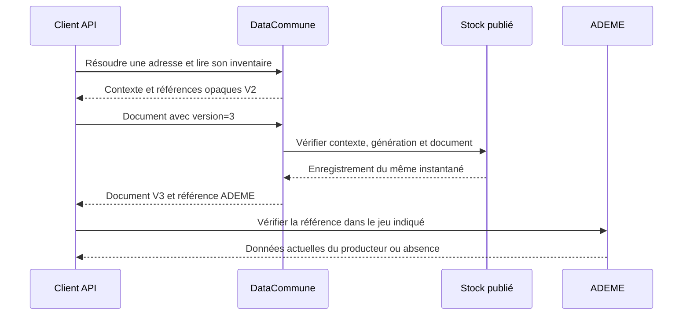

# Premier contrat exécutable : identifier un document DPE

**Cible, non implémentée.** Ce document tranche les options de la [revue API](socle-api-revue.md) pour le plan 63-01. Il ne remplace pas le contrat courant en production. L'API et ses pipelines constituent le socle ; l'interface consommera ce contrat dans le lot suivant.

## Résultat attendu

Un client HTTP indépendant du site ouvre un document déjà présent dans l'inventaire, obtient sa référence ADEME et ses sources, puis retrouve cette référence chez le producteur. Il n'a besoin ni d'une attribution automatique au logement ni d'un nouveau moteur de rapprochement.

## Route et compatibilité

Réutiliser `GET /v1/bien/dpe/document?contexte={opaque}&reference={opaque}`.

- Sans paramètre `version`, ou avec `version=2` : comportement V2 actuel, mêmes champs et invariants ; aucune identité source nouvelle dans cette réponse.
- Avec `version=3` : document V3, enrichi du seul objet `source_identity` ci-dessous.
- Toute autre version : validation HTTP 422. Pas de bascule globale, nouvelle route ou migration de données.
- La V3 conserve les champs V2, sauf le discriminant `version=3`. C'est une variante opt-in, pas une attribution plus précise.
- Authentification, quotas, références HMAC, génération/date, relecture à la cible et `Cache-Control: no-store` restent les mêmes.
- L'inventaire et Resolve restent V2. Les clients actuels ne demandant pas V3 reçoivent leur contrat inchangé.



L'API DataCommune ne contacte pas l'ADEME pendant cette lecture : panne du producteur et panne de notre lecture restent indépendantes. La vérification externe ne réécrit pas le stock et peut révéler une modification survenue depuis sa capture.

## Objet ajouté

Extrait de réponse **attendue**, pas réponse d'une API déjà modifiée :

```json
{
  "version": 3,
  "source_identity": {
    "reference": "2644E0008262R",
    "sources": [
      {
        "dataset": "dpe03existant",
        "url": "https://data.ademe.fr/datasets/dpe03existant"
      }
    ]
  },
  "type_batiment": "maison",
  "surface_habitable": 79.0,
  "etiquette_dpe": "D"
}
```

| Champ | Règle |
|---|---|
| `source_identity.reference` | Numéro source `record.dpe_number` conservé tel quel, chaîne non vide ; ne jamais utiliser un ID SQL ou la référence HMAC à sa place |
| `source_identity.sources` | Liste dédupliquée et déterministe des régimes établis par les observations validées du document ; au maximum deux jeux connus |
| `sources[].dataset` | Enum fermé `dpe03existant` ou `dpe02neuf` |
| `sources[].url` | Constante de catalogue correspondant exactement à l'enum ; aucune URL issue d'un texte libre |

`existant` correspond à `dpe03existant` et `neuf` à `dpe02neuf`. Utiliser les observations/lifecycle validés déjà utilisés pour la provenance ; pour un enregistrement ancien sans observations, le régime explicite et reconnu peut fournir le lien. Si aucune origine n'est établie, `sources=[]` et référence conservée. Si plusieurs régimes sont établis, conserver les deux dans l'ordre existant puis neuf, sans choisir arbitrairement. Les incohérences actuellement bloquantes restent bloquantes.

Le lien est **la page du jeu de données**, pas un PDF ni une promesse de page individuelle. Son libellé futur : « Source ADEME — logements existants » ou « Source ADEME — logements neufs ». La référence affichée permet la vérification ; le client de recette utilise en plus une recherche API exacte par numéro, comme dans les preuves jointes.

Une tombstone conserve sa référence et les régimes réellement connus. Ses valeurs descriptives restent purgées ; le lien source n'affirme pas que le document est encore présent chez le producteur.

## Ce qui ne change pas

- `association=source_ban_equality`, `address_check=unverified`, compteurs, distributions et attribution logement.
- Dates, calculs de validité, remplacements et état de publication ; aucune fabrication d'`imported_at`.
- Inventaire paginé et minimisation du SSR initial.
- Aucun nouveau champ d'adresse brute, complément, étage, ID BAN/RNB, historique d'observations interne ou identité d'occupant n'est exposé dans ce plan.
- Aucune recherche par numéro seul, aucun changement des requêtes d'import, aucun rapprochement spatial.

Le contrat général conserve les adresses brutes en interne ; leur projection utile à la recherche divergente sera définie au livrable 2. Cela évite de transformer le premier contrat documentaire en audit de tous les textes libres.

## Erreurs et frontières

| Entrée/état | Sortie attendue |
|---|---|
| Référence ou contexte invalide | 400 constant, aucun reflet du contenu |
| Référence/génération à rafraîchir | 409, relancer Resolve puis consulter avec nouvelles références |
| Publication/lecture indisponible | 503 ; jamais un succès vide |
| Version autre que 2 ou 3 | 422 |
| Ancien serveur ignorant `version=3` | Client de recette refuse son `version=2` : pas de faux succès V3 |
| Document supprimé, trace conservée | V3 documentaire minimale si le contexte permet la lecture, aucun descriptif ressuscité |

Une référence officielle exposée a une finalité documentaire. Elle reste absente des URLs internes, logs ajoutés, télémétrie et enveloppes SSR. Le client de recette conserve ses secrets en environnement ; les reçus retirent les références opaques et en-têtes d'authentification.

## Témoins réels et tests adverses

Les deux recherches exactes ADEME ont été exécutées pendant ce cadrage : [réponses et URL](socle/source-references.json).

| Cas | Référence / source | Attendu documentaire |
|---|---|---|
| R06 | `2644E0008262R` / existant | Maison, 79 m², D, 05/01/2026 |
| R04 | `2685N1020238T` / neuf | Maison, 81,9 m², C, 13/04/2026 |

La preuve de contrat porte sur ces champs et la référence, pas sur une identité physique certifiée. Les réponses ADEME sont datées ; si elles changent, enregistrer la nouvelle observation et expliquer le delta avant de modifier les attendus.

Tests adverses : V2 sans nouveaux champs ; V3 ne traverse pas un contexte voisin ; génération périmée ; date changée ; panne ; double régime ; régime inconnu ; tombstone ; source URL hostile injectée dans des données internes ; valeur secrète sentinelle dans un complément d'adresse ; champs V2 identiques sous projections V2/V3 sur le même instantané.

## Critère de sortie du plan 63-01

La V3 est prouvée localement avec PostgreSQL/PostGIS et un client HTTP indépendant ; V2 est préservée, les cas négatifs bloquent, les deux références source sont traçables. Ce résultat **ne clôt pas** la phase 63 : affichage de première vue, recherche divergente et sélection restent à réaliser. CI, préproduction, production et acceptation visuelle ont chacun leur état propre.
