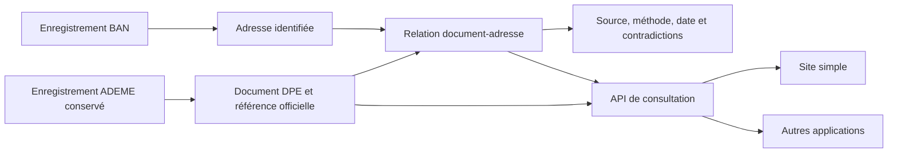

# Lecture du cadrage externe — 10 septembre 2026

> Suite au « Go » utilisateur après cette lecture, l'orientation recommandée est adoptée dans [SOCLE-DONNEES.md](SOCLE-DONNEES.md) et le premier plan 63-01. Les formulations « proposition » ci-dessous décrivent le moment de la revue ; elles ne remplacent pas ce cadrage courant.

Document examiné : cadrage de plateforme territoriale (`cadrage-plateforme-donnees-territoriales-francaises.md`, document Codex local, hors dépôt), sections consolidées 1–18 et recadrage utilisateur dans l'annexe. Il s'agit d'une proposition, pas d'une implémentation ni d'une preuve de fonctionnement.

## Ce qui change la vision

Le recadrage utilisateur dans l'autre conversation désigne explicitement la base, les pipelines et l'API comme produit principal ; le site devient un client. Cette ambition dépasse la réparation de l'interface DPE. La demande dans cette tâche est d'analyser le document : elle ne déclenche pas automatiquement la réécriture de la roadmap adoptée juste avant.

**Recommandation :** utiliser adresse → DPE comme première démonstration du socle de données. Avant d'exécuter le premier livrable de la phase 63, confronter cette orientation aux décisions de son contexte, puis formaliser objets, liens, pipeline et résultat attendu. Conserver le code et les corrections ; une nouvelle technologie ou un nouveau dépôt ne résoudrait pas à lui seul un lien mal défini.

## Idées utiles confrontées à nos preuves

| Proposition | Apport concret à DataCommune | État de preuve |
|---|---|---|
| Séparer entités, observations et relations | Une adresse identifie une adresse ; un DPE reste un document ; la relation au logement doit être établie séparément | L'inventaire actuel est exact-BAN et son statut positif reste systématiquement `unassigned` dans le code audité |
| Conserver les sources avant de décider leurs liens | Un DPE mal géocodé reste consultable et peut être retrouvé autrement | L'import est filtré par département BAN et rejette les coordonnées invalides ; nos contrôles ne donnent pas un recensement national des documents exclus |
| Conserver les éléments favorables et contradictoires d'un rapprochement | R09 : brut 111 rue des Carterons contre BAN 113. R11 : brut 38 rue Alexandre-Huchon contre BAN 21 rue Benoît-Chupiet | Divergences reproduites ; le bâtiment/logement réel n'est pas certifié par ces seules observations |
| Versionner les sources, règles, liens et publications | Expliquer un changement et reconstruire un résultat daté ; qualifier une deuxième ingestion, y compris corrections et retraits | Des mécanismes existent déjà. Leur couverture doit être comparée au contrat proposé avant tout remplacement |
| Évaluer les règles sur des cas indépendants | Séparer tests de régression, mesure de couverture et preuve d'attribution | L'audit contient 16 cas ciblés ; il ne mesure pas une précision nationale et ne contient pas de vérité propriétaire indépendante |
| Réutiliser les relations RNB/BDNB disponibles | Examiner les liens des référentiels avant d'inventer des rapprochements spatiaux supplémentaires | Proposition à tester sur les cas divergents ; leur présence et leur justesse pour ces adresses ne sont pas acquises |

Preuves locales : [audit du code](dpe-code.md), [tests réels](TESTS-REELS.md), [limites de validation](VALIDATION.md). Code audité `3394395a`, préproduction observée `41f140a6` ; aucun constat nouveau sur la production pendant cette lecture.

## Schéma à retenir

La consultation d'un document ne doit pas dépendre de la preuve complète de son attribution à un logement. Inversement, consulter ou sélectionner ce document ne certifie pas automatiquement cette attribution.

## Points à ne pas adopter mécaniquement

- L'exemple API `diagnostics: []` avec candidats séparés peut recréer l'impasse visuelle actuelle si le site n'affiche que la première liste. Définir ensemble l'API et le résultat visible de chaque état.
- Dagster est une proposition d'orchestration, pas une correction démontrée de nos liens. Conserver les traitements testables indépendamment ; évaluer l'outil sur un problème d'exploitation mesuré.
- Le modèle entités/observations/relations décrit le métier ; il n'oblige ni à une base graphe, ni à un stockage générique unique, ni à migrer tous les datasets d'un coup.
- Vingt puis deux cents cas sont des objectifs de constitution de corpus, pas des seuils garantissant la fiabilité de toute la France.
- Le modèle économique, les budgets, l'ensemble des licences et les concurrents du document n'ont pas été revalidés dans cette lecture technique.

## Point nouveau vérifié auprès de la source

La [FAQ officielle BAN](https://doc.adresse.data.gouv.fr/docs/documentation-generale/utiliser-la-base-adresse-nationale/identifiants-gestion-et-guide-pratique/faq-identifiants), consultée le 10 septembre, documente des identifiants UUID et leur transition avec la clé d'interopérabilité. Il faut examiner les formats réellement consommés par DataCommune et prévoir les correspondances ; cette lecture ne démontre pas une rupture actuelle de notre import.

## Suite proposée

Compléter le cadrage adopté par quatre vues : objets et granularités ; liens autorisés et preuves ; ingestion/publication et changements ; parcours API/site sur R06, R09/R11 et R14. Évaluer les mécanismes déjà présents contre ces vues, puis ne planifier que les écarts. Cette recommandation reste distincte d'une décision de pivot adoptée dans la tâche principale.
