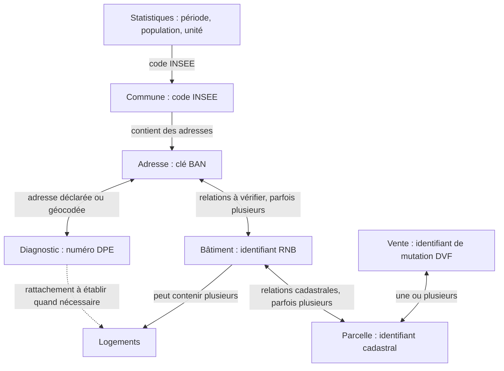
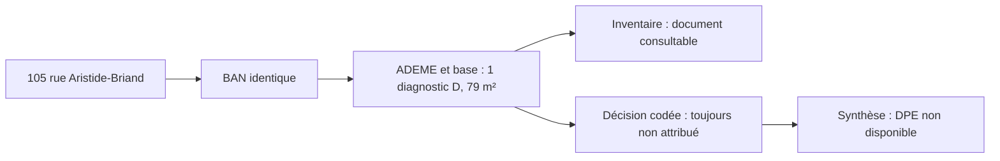
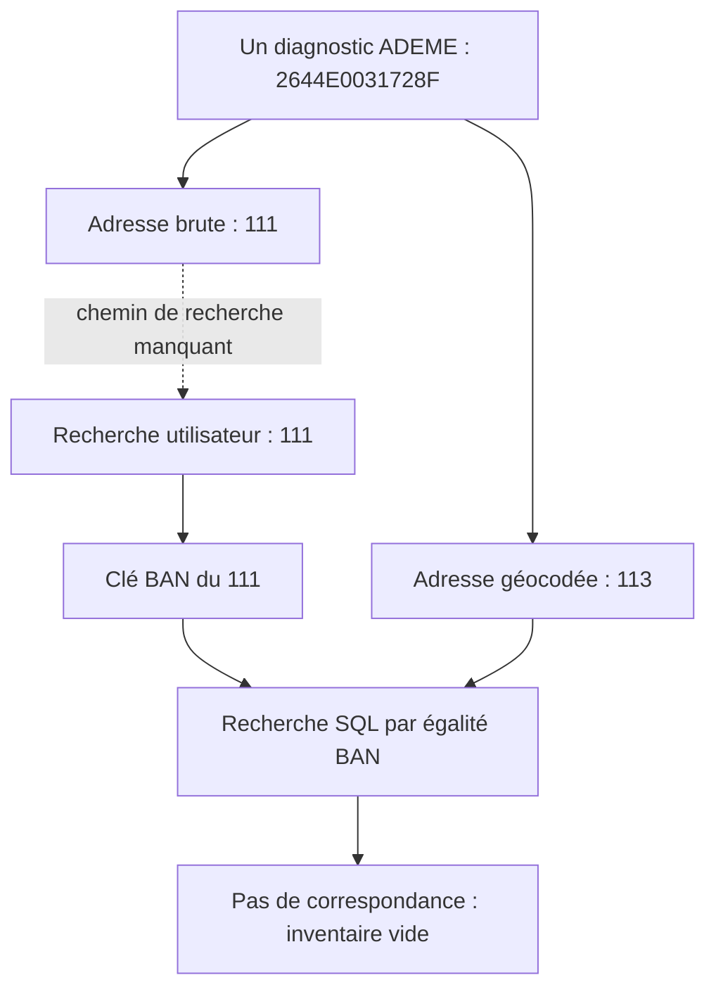
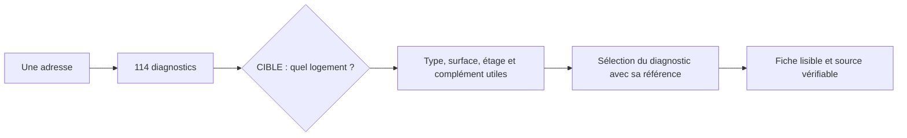
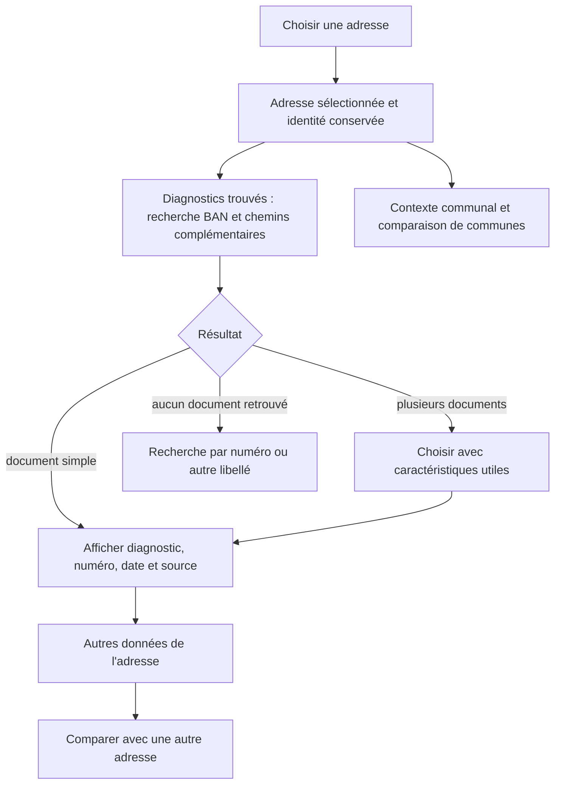

# Retrouver un DPE, comprendre une adresse, comparer des lieux

Plan de recentrage préparé le 10 septembre 2026. **Proposition, pas modification de la roadmap ni autorisation de publication.**

## Le résultat à obtenir

Une personne choisit une adresse, voit immédiatement les diagnostics trouvés avec leur référence ADEME et peut retrouver celui de son logement. Elle consulte ensuite les ventes, les risques et les informations communales, puis compare deux adresses ou deux communes sans mélanger leurs chiffres.

Le parcours normal ne commence pas par « non attribué ». Une difficulté de rapprochement doit déclencher une recherche complémentaire ou un choix utile. Un document réellement absent des sources ne peut pas être inventé ; il faut permettre une recherche par numéro et indiquer ce qui a effectivement été recherché.

**Recommandation : conserver le dépôt et les acquis vérifiés. Reprendre la conception du parcours, puis corriger une chaîne complète à la fois.** Terminer les anciennes cases GSD ne doit plus remplacer la réussite du parcours utilisateur.

## Lire le dossier visuellement

| Question | Schémas et preuves |
|---|---|
| Où se situe chaque donnée ? | Schéma des entités ci-dessous ; [matrice des datasets](datasets.md) |
| Pourquoi mon DPE ne ressort pas ? | Cas réels ci-dessous ; [chaîne DPE actuelle et corrections](dpe-code.md) |
| Comment marchent les autres fonctions ? | [Atlas fonctionnel : actuel et cible](fonctionnalites.md) |
| Qu'a-t-on réellement testé ? | [Résultats, sources et limites](TESTS-REELS.md), [entrées rejouables](cases.json) |
| Dans quel ordre corriger ? | Lots A à F ci-dessous |

Les schémas décrivent soit **ACTUEL vérifié dans le code / observé**, soit **CIBLE proposée**. Un schéma cible ne constitue pas une fonctionnalité livrée.

## Les objets que nous devons relier

Une adresse n'est pas une clé universelle. Chaque source décrit un objet différent. La solution consiste à conserver les identifiants propres aux objets et à **documenter les relations entre eux**, avec leur origine, leur date et leurs contradictions. Le texte d'adresse aide à rechercher ; la proximité géographique aide à proposer des candidats. Aucun des deux ne doit écraser silencieusement une identité source.

Ce modèle réutilise BAN, RNB, cadastre et les relations existantes. Il ne nécessite pas de créer tout de suite un nouveau graphe, moteur ou service.

## Trois cas qui expliquent le problème

### Cas 1 — le document est là, mais le parcours le traite comme une impasse

**R06 : 105 rue Aristide-Briand, 44400 Rezé.** L'ADEME retourne le numéro `2644E0008262R`, maison, 79 m², D, établi le 05/01/2026. L'API DataCommune retourne les mêmes valeurs. Le navigateur montre le document D, mais commence par « Attribution au logement non établie », puis la synthèse affiche l'étiquette comme indisponible.

**Correction cible :** afficher le diagnostic trouvé dès le premier écran, avec numéro, date, surface et source. Une consultation documentaire utile ne dépend pas d'une certification automatique de l'identité du logement. Si une sélection est nécessaire, elle porte sur les diagnostics et leurs caractéristiques ; elle ne devient pas une nouvelle preuve officielle par le seul clic de l'utilisateur.

### Cas 2 — la source se contredit sur l'adresse

**R08/R09 : 111 et 113 rue des Carterons, 44400 Rezé.** Le diagnostic `2644E0031728F` porte « 111 rue des Carterons » dans l'adresse brute, mais la clé BAN pointe vers le 113. Notre recherche trouve un document au 113 et zéro au 111.

**Correction cible :** rechercher également dans l'adresse brute normalisée et les relations de bâtiment ; faire apparaître le document comme candidat avec sa discordance, puis résoudre le rattachement à partir de l'original ou de données supplémentaires. **L'audit ne tranche pas si le 111 ou le 113 est la bonne adresse physique.** Il démontre que le document existe et que le chemin de recherche actuel ne le retrouve pas depuis son adresse brute.

Le même mécanisme est observé pour **R11 : 38 rue Alexandre-Huchon, Rezé**, dont un diagnostic source est géocodé au 21 rue Benoît-Chupiet.

### Cas 3 — une adresse donne plusieurs logements

**R14 : 20 route de Carquefou, 44300 Nantes.** L'ADEME et DataCommune donnent 114 diagnostics. Les six pages ont été parcourues : 114 références distinctes, sans duplication. Les cinq champs comparés correspondent aux lignes ADEME.

Aujourd'hui, le numéro DPE et les compléments permettant de distinguer les appartements ne sont pas exposés par le détail public. La pagination fonctionne ; **la sélection utile reste à construire**.

## Ce qui coince : constat, conséquence, correction

| ID | Constat et niveau de preuve | Conséquence | Changement à prévoir |
|---|---|---|---|
| D01 | Code + 13 inventaires positifs réels : décision toujours `unassigned` | Les protections empêchent le résultat central attendu | Séparer résultat documentaire, choix utilisateur et attribution automatique ; ouvrir le parcours positif |
| D02 | R09 et R11 : texte source et BAN divergent ; recherche uniquement BAN | Un document connu n'est pas retrouvé depuis son adresse brute | Index de recherche complémentaire, variantes d'adresse et rapprochements RNB traçables |
| D03 | Schéma API et écran R06 : numéro ADEME absent, étage/complément absents | Vérification externe et choix d'appartement difficiles | Réexaminer l'allowlist ; exposer référence et informations de distinction nécessaires, sans identité des occupants |
| D04 | Code : imports filtrés par département BAN, puis coordonnées valides | La couverture déclarée ne mesure pas les lignes éliminées avant import | Census indépendant et conservation documentaire avant géocodage ; mesurer les pertes avant de décider le rattrapage |
| D05 | API réelle : snapshot source daté, mais `imported_at=null`, couverture inconnue | Réserves répétées et absence de visibilité sur la fraîcheur | Faire remonter la génération d'import existante et définir la couverture mesurée ; ne pas convertir « import complet » en couverture de tous les logements |
| D06 | R12 : `missing_target` dans le graphe de remplacement | Le prédécesseur cité n'est pas dans le périmètre importé | Vérifier le numéro remplacé dans la source nationale ; représenter histoire et état courant séparément |
| D07 | Code : inventaire conserve historiques et traces, ordre lexical | Le premier document n'est pas nécessairement le document courant | Vue de consultation lisible, regroupement des remplacements explicites, historique accessible ; pas de maximum par date à l'adresse entière |
| U01 | Écran R06 frais + rejet utilisateur : résultat D enfoui après tableaux et avertissements | L'interface paraît dire que la donnée manque alors qu'elle la montre plus bas | Première vue : adresse + diagnostic(s) + action ; détails techniques dans méthode/source |
| U02 | Écran R06 : GES/surface portent aussi une réserve générique « non couverte » | Une non-attribution devient visuellement une absence de collecte | Distinguer absence source, panne, sélection nécessaire et information effectivement connue |
| J01 | Code : ventes au grain mutation/parcelle ; risques et urbanisme au point | Risque de comparer des grandeurs d'objets différents | Libellés de périmètre simples, relations explicites et règles de comparabilité |
| C01 | Comparateur de communes présent ; comparateur d'adresses absent | L'objectif produit n'est pas entièrement implémenté | Ajouter une tranche de comparaison d'adresses après fiabilisation des fiches |
| P01 | Preuves CI/préproduction acquises, UAT non acquise et interface rejetée | « Phase terminée » devient trompeur pour piloter | Suivre séparément code, données, déploiement et réussite utilisateur |

D04 quantifie une **limite du protocole de couverture**, pas un nombre de DPE manquants déjà établi. D07 ne prouve pas que tous les documents montrés sont invalides. Les tests présents ne permettent pas d'affirmer que tous les chiffres des 27 sources sont erronés ou corrects.

## Le parcours cible

Une correspondance ambiguë ne doit pas entraîner un faux DPE. Elle ne doit pas non plus masquer les documents disponibles. Pour l'attribution automatique, les règles devront être testées sur des diagnostics dont l'appartenance au logement est établie indépendamment. BAN + surface + type seuls ne garantissent pas universellement une identité.

## Plan exécutable, dans l'ordre

### Lot A — fixer le contrat et le corpus de vérité

**Livrable :** schémas validables, cas réels annotés, contrat API/UI et liste courte des critères de réussite. Réutiliser ce dossier ; ne pas redémarrer une exploration générale.

- Garder les 16 recherches de l'audit comme régressions de recherche. Pour R09/R11, annoter « contradiction non résolue », sans inventer la bonne attribution.
- Constituer un corpus indépendant de **30 logements minimum**, objectif initial de recette et non seuil statistique de fiabilité nationale : 10 maisons simples, 10 appartements, 10 cas difficiles. Document original ou confirmation documentée adresse/logement/numéro ; mélanger 44/85, ancien/neuf, remplacements, multi-adresses, suffixes et sources sans BAN.
- Ajouter des cas négatifs : DPE de voisin, deux appartements de même surface, diagnostic collectif, numéro absent, source indisponible, adresse hors 44/85. Aucune identité de résident nécessaire.
- Préparer trois écrans de parcours : un diagnostic, plusieurs, aucun trouvé. L'utilisateur doit retrouver la classe, la date et la source sans lire les réserves techniques. Les schémas d'architecture restent dans la documentation.

**Contrôle de sortie :** pour chaque cas, entrée → document attendu → preuve → résultat actuel → résultat cible. Les cas sans vérité logement sont exclus du calcul de précision d'attribution. On peut améliorer l'affichage documentaire avant de réunir tout le corpus d'automatisation.

### Lot B — retrouver les documents et permettre leur vérification

**Dépendance :** contrat de lecture du lot A. **Responsabilité :** chaîne `resolve`, `dpe`, API documentaire et première vue de fiche.

- Conserver la clé BAN choisie dans l'autocomplétion au lieu de dépendre d'une nouvelle interprétation du slug ; traiter anciennes URL sans les casser.
- Maintenir le chemin BAN exact déjà fiable, ajouter recherche d'adresse brute normalisée, variantes/suffixes et relations RNB. Enregistrer la raison de chaque candidature ; jamais une correction silencieuse du numéro de rue.
- Permettre la recherche exacte par numéro DPE et un lien vers la source vérifiable. Réexaminer les champs masqués avec l'objectif de choix du logement : numéro, type, surface, étage et complément utile.
- Refaire la première vue autour du diagnostic consulté. Une sélection utilisateur est traçable et modifiable ; ne pas la présenter comme une validation automatique indépendante.

**Découpage pour éviter une nouvelle grosse phase :** B1 = R06, référence ADEME et première vue avec l'inventaire existant ; B2 = conservation de la clé et recherche des discordances R09/R11 ; B3 = choix de logement dans les grands inventaires R14. Chaque sous-lot doit être démontrable seul.

**Contrat de candidature :** numéro exact d'abord ; adresse BAN exacte ; ensuite texte brut normalisé avec numéro/suffixe et commune vérifiés ; enfin relation RNB justifiée. Les chemins complémentaires ajoutent des candidats, ils n'attribuent rien automatiquement. Un plafond doit être explicite dans l'API et l'UI, avec pagination ou critères pour continuer, jamais un résultat silencieusement tronqué. Une collision de texte retourne plusieurs candidats avec leur provenance ; ni premier résultat, ni plus proche géographiquement, ni score de géocodage ne gagne seul. R09/R11 doivent conserver simultanément adresse recherchée, adresse brute et BAN source.

**Champs exposés :** numéro, classe, dates, type, surface et étage structuré forment le premier contrat. Les adresses brutes et compléments sont des textes libres : définir champ par champ ce qui aide à distinguer bâtiment/escalier/étage/porte, masquer les noms et coordonnées de personnes éventuellement saisis, échapper le contenu dans tous les rendus et exports. Tester ces cas avant exposition ; garder un lien source quand le texte ne peut pas être publié proprement. Cette revue ciblée ne doit pas retarder B1.

Les trois notions restent distinctes dans le contrat : document source consulté, sélection utilisateur déclarative/révocable, attribution automatique validée.

**Contrôles de sortie :** R06 montre D/79 m²/numéro/date au premier niveau ; R09/R11 retrouvent le document contenant l'adresse recherchée et affichent la divergence ; R14 permet de trouver un diagnostic sur toutes les pages ; rien de ces choix ne modifie les agrégats communaux. Test négatif indispensable : rechercher le 111 ne doit pas certifier automatiquement le document comme DPE du 113, ni l'inverse.

### Lot C — combler les trous d'import et maîtriser le cycle de vie

**Dépendance :** protocole du lot A ; recherche documentaire B indépendante d'une refonte complète de l'ETL.

- Comparer le périmètre BAN à un census construit avec plusieurs signaux sources indépendants du géocodage : champs bruts de commune/code postal, relations disponibles et éventuelles coordonnées. Le code postal brut seul n'est pas une vérité de commune : contradictions à compter séparément.
- Conserver le document source avant validation géographique ; séparer existence du DPE et capacité à le placer. Importer/relier les documents récupérables avec provenance.
- Pour chaque génération, rapprocher numéros reçus, doublons, lignes conservées, géométries manquantes, départements contradictoires, traces de retrait et documents publics.
- Vérifier les remplacements à l'échelle appropriée, dont le prédécesseur R12 ; traiter les révisions officielles selon les champs et sources effectivement disponibles. Aucune réécriture de classe au jugé.
- Distinguer date de publication source, snapshot, import et consultation. Rendre les incidents observables en interne ; un bloc sources compact suffit côté utilisateur.

**Contrôles de sortie :** aucune disparition de numéro inexpliquée entre source et import ; chaque écart classé et rejouable ; aucune ligne rejetée pour géométrie ne disparaît de la recherche par numéro ; cas expiré/remplacé/retiré/futur/cycle testés. En préproduction, comparer avant/après sur les mêmes générations et le corpus. Les 14 parités exactes de cet audit ne doivent pas régresser.

### Lot D — ouvrir l'attribution automatique sur les cas démontrés

**Dépendances :** identité documentaire B, cycle de vie C, cas de vérité logement A.

- Écrire une table de décision courte. Document exact par numéro, logement confirmé et historique cohérent : afficher le diagnostic correspondant. Maison simple avec relations non contradictoires : automatiser seulement après qualification du critère de simplicité. Collectif : sélection par caractéristiques ou référence du logement.
- Pour un même logement prouvé, classer les documents par relations de remplacement et règles officielles ; ne pas choisir le plus récent à l'échelle de l'adresse entière.
- Mesurer séparément recherche des documents, bonne sélection du diagnostic et automatisation correcte. Donner les effectifs et types de cas ; jamais un score de confiance arbitraire.
- En cas contradictoire, proposer le candidat et les informations qui permettent de le départager. L'affichage documentaire B reste utilisable.

**Contrôle de sortie :** aucun faux rattachement dans le corpus annoté, tous les cas positifs de recette réussissent, voisins et appartements semblables ne sont pas confondus. Un échantillon de 30 ne prouve pas « 100 % partout » : publier le périmètre d'automatisation effectivement validé, étendre ensuite les cas.

**Périmètre initial d'automatisation fermé :** identifiant exact du diagnostic et relation au logement documentée indépendamment, ou règle déterministe explicitement qualifiée sur une entité unique ; relations contradictoires, simple proximité ou ressemblance de surface restent des chemins de recherche assistée. Figer les règles avant d'exécuter un jeu de cas réservé distinct des cas de développement, réparti entre maisons, appartements et contradictions. Toute collision sur ce jeu suspend la règle concernée. Si un score probabiliste est proposé plus tard, il nécessitera son propre objectif de précision, protocole de mesure et intervalle d'incertitude ; il ne fait pas partie de la première livraison.

### Lot E — rendre les fiches et comparaisons compréhensibles

**Dépendance :** B pour la fiche DPE ; les schémas et maquettes peuvent avancer pendant C. Pas de quatre modifications concurrentes du même contrat de données.

- Fiche adresse : diagnostic choisi en premier, ventes de la parcelle et risques ensuite ; contexte communal repliable. Une seule présentation de chaque information.
- Vérifier DVF, cadastre, Géorisques et GPU avec des cas réels reliés à leurs sources. Cibles initiales : R06 et Rio, puis une mutation multi-locaux/multi-parcelles, un immeuble d'angle et une zone réglementaire en limite. Sélectionner les vrais cas avant de coder ; ne pas inventer un prix au m² individuel.
- Commune : limiter la première vue aux questions prioritaires ; expliciter période, unité et population des indicateurs. Réutiliser les preuves de qualification des 460 communes ; traiter séparément les réserves encore ouvertes de loyers, LOVAC et stabilité historique.
- Comparateur communal : conserver la paire 44109/85191 et la parité déjà testée. Ajouter les écarts seulement pour des indicateurs comparables ; aucun classement arbitraire « meilleure commune ».
- Comparateur d'adresses : construire deux fiches avec la même structure ; chaque ligne compare le même objet et la même unité. Distinguer la classe du logement choisi, une vente sur parcelle et une moyenne communale. Les deux adresses d'un même bâtiment ne représentent pas automatiquement deux logements distincts.

**Contrôle de sortie :** contrôles API/source puis navigateur 375 px et desktop, avec les mêmes cas ; l'utilisateur retrouve un DPE, explique la portée d'un prix, compare deux lieux et ouvre la source. La réussite visuelle ne se déduit pas de tests CSS verts. La validation humaine ne sera enregistrée qu'après un retour explicite.

### Lot F — exports et livraison de la tranche validée

**Dépendance :** contrat des fiches et comparaisons E ; B/D selon le résultat livré.

- Conserver les exports existants et leurs protections. Distinguer impression navigateur et vrai rapport PDF.
- Fournir un résumé lisible en premier, puis les sources et détails ; fixer le contenu avant une pagination cible. Les PDF déjà produits prouvent le fonctionnement, pas la qualité de lecture.
- Exporter le même diagnostic sélectionné et les mêmes chiffres que l'écran ; numéros, unités, dates, périmètres et sources doivent survivre à l'export.
- Livrer par le circuit PR/CD existant après les contrôles requis. Vérifier le SHA, la génération des données et les parcours sur l'environnement publié.

**Contrôle de sortie :** parité écran/API/CSV/PDF sur cas réels, aucune fuite d'identité d'occupant, liens fonctionnels, déploiement et résultat utilisateur vérifiés séparément. Un correctif local ou préproduction n'est pas déclaré livré en production.

## Comment reprendre GSD sans perdre le travail

| Phase | Ce qu'on garde | Ce qui reste / rattachement proposé |
|---|---|---|
| 58.2 | Imports, réconciliation, gains de couverture mesurés | Complément de mesure C ; ne pas annuler les gains |
| 58.3 | Inventaire, consultation et comparaison factuelle | Résultat utilisateur incomplet : B et D, après contrat A |
| 59.1 | Indicateurs et preuves de parité des communes | Réserves données/historique et nouvelle recette de lisibilité E |
| 59.2 | Protections de grain, exports, hiérarchie testée | Repenser la première vue E ; acceptation utilisateur non acquise |
| 60 | Comparateur communal de deux communes vérifié en préproduction | Lisibilité E, acceptation humaine et vérification production |
| 60.1 | Fonctionnalités encore à faire | Écarts et export seulement après comparabilité E/F |
| 61, 62, 62.1 | Intentions de roadmap conservées | Ne pas lancer avant réussite adresse → DPE ; reprendre leur périmètre ensuite |
| Comparer deux adresses | Objectif utilisateur explicite | Nouvelle tranche à inscrire lors de l'adoption du plan E ; absente du produit actuel |

Le dossier racine et le worktree intégré ne portent pas la même révision. L'audit utilise le code intégré `3394395a` et le service préproduction `41f140a`. Avant exécution, reprendre le checkout intégré et vérifier son état ; ne pas recopier aveuglément un ancien STATE. Les documents historiques restent des preuves datées.

**Prochaine tranche recommandée : A puis B.** Elle produit rapidement un parcours vérifiable avec les documents déjà présents. C et D renforcent ensuite couverture et automatisation. La préparation des maquettes peut se faire en parallèle des mesures, une fois le contrat partagé fixé.

## Limites à conserver dans le plan

Les 16 recherches sont des cas choisis pour révéler des mécanismes, pas un échantillon représentatif de la France. Les tests frais portent sur la préproduction, pas sur `datacommune.fr`. Aucun document original de propriétaire n'a été collecté pour certifier l'identité d'un logement. Les autres datasets ont été cartographiés, pas tous réaudités sur des sources fraîches aujourd'hui. Le benchmark concurrent n'a pas fourni de résultat individuel exploitable dans le navigateur pendant cet audit.

Ces limites ne justifient pas l'impasse actuelle : les documents disponibles doivent être retrouvables, lisibles et vérifiables. Elles définissent les preuves supplémentaires à obtenir avant de promettre une attribution automatique universelle.
