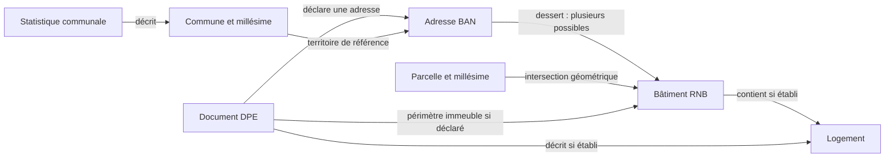
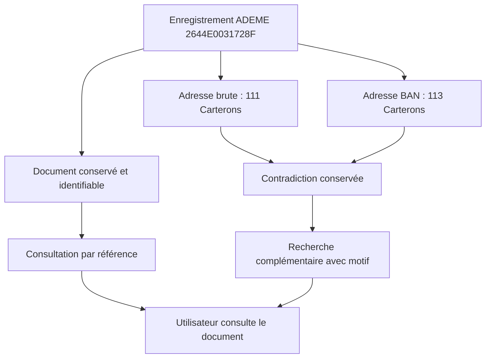
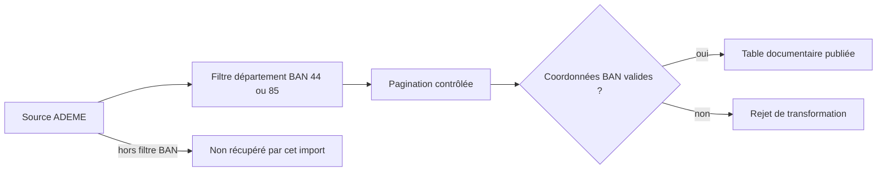
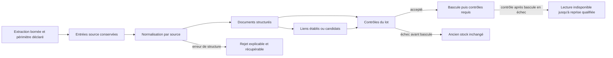
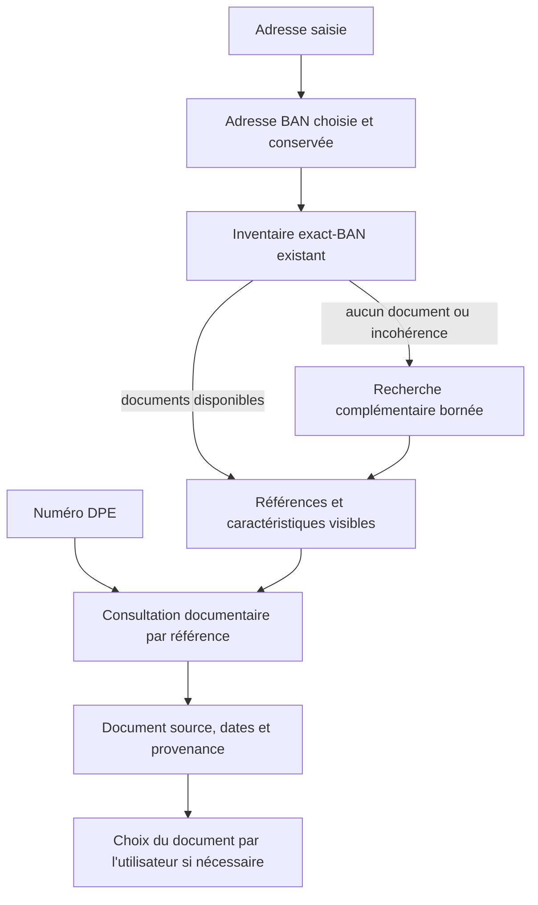
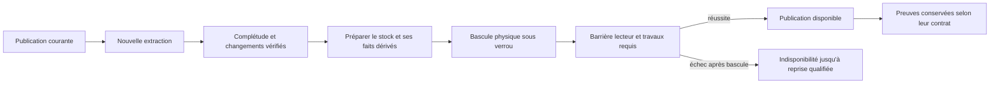

# Le socle DataCommune : objets, liens et résultats

**Décision du 10 septembre 2026 :** construire sur le dépôt existant un socle de données publiques accessible par API. Le parcours adresse → DPE est son premier témoin complet. Le site doit rendre ce résultat compréhensible ; il ne décide pas des rapprochements.

Ce contrat décrit la cible et la méthode de transition. L'existant est documenté au commit intégré `3394395a32e9a778c89930ad7544406da265163e`. Les observations HTTP du 10 septembre portent sur la préproduction `41f140a6`, pas sur une nouvelle version de production. Les nombres cités ne sont pas des estimations nationales.

## 1. Les objets : qu'identifie chaque clé ?

| Objet | Identité à conserver | Ce qu'il ne faut pas lui faire dire |
|---|---|---|
| Adresse | Identifiant BAN, type d'identifiant, libellé et version/capture de référence | Une adresse ne désigne pas nécessairement un seul bâtiment ni un seul logement |
| Bâtiment | Identifiant RNB lorsque disponible, origine du lien et état observé | Un bâtiment BD TOPO ou un groupe BDNB n'est pas automatiquement la même entité RNB |
| Parcelle | Référence cadastrale complète et millésime/capture | Une parcelle ne correspond pas nécessairement à un seul bâtiment ou bien vendu |
| Logement | Identité explicitement documentée lorsqu'elle existe | Ni le numéro DPE, ni une paire surface/étage n'est un identifiant universel de logement |
| Diagnostic | Référence ADEME et régime source ; état courant et observations de provenance aujourd'hui, historique documentaire complet à définir | Un numéro identifie un document, pas tous les logements à son adresse |
| Mutation DVF | Identifiant de mutation dans une publication, dispositions et parcelles | Les lignes répétant une valeur ne représentent pas plusieurs ventes indépendantes |
| Commune | Code INSEE et millésime géographique | Un agrégat communal ne décrit pas directement un logement |
| Observation | Source, enregistrement, période, valeur, unité et grain | Une prédiction ou une moyenne ne devient pas une mesure individuelle |

Les identifiants restent des chaînes. Conserver zéros initiaux, suffixes et espace de noms. L'identifiant BAN UUID et l'ancienne clé d'interopérabilité se distinguent explicitement ; aucune conversion ne se déduit d'une simple ressemblance de texte.

Les flèches indiquent des **types de relations possibles**, pas des liens déjà prouvés pour toutes les lignes. Adresse, bâtiment et parcelle admettent des relations multiples ; aucune transitivité automatique vers le logement.

## 2. Une donnée et son rattachement ont des vies différentes

Exemple réel R09 : la source comporte le DPE `2644E0031728F`, avec une adresse brute au **111 rue des Carterons** et une adresse BAN au **113**. La consultation actuelle au 111 n'en retrouve aucun ; au 113, un document est disponible. Cette contradiction prouve un défaut du chemin de recherche, pas lequel des deux numéros décrit physiquement le logement.

**Contrat d'une relation**, à appliquer au stockage existant et aux nouveaux rapprochements nécessaires :

| Champ logique | Règle |
|---|---|
| Origine et cible | Identifiants typés, grain et version de référence |
| Nature | `source_ban_equality`, déclaration RNB, intersection, candidat de recherche, sélection utilisateur : significations séparées |
| Origine de l'information | Producteur, enregistrement, saisie déclarée ou calcul amont/local |
| Méthode | Nom/version de la règle et données utilisées |
| Éléments de preuve | Concordances, contradictions et candidats concurrents ; origine commune des preuves conservée |
| Décision | Candidat, lien accepté au grain annoncé, rejet ou lien périmé ; motif lisible |
| Temps | Date de connaissance, période de validité lorsqu'elle est connue, version des entrées |

Ce modèle métier **n'impose pas une table générique unique**. Le premier livrable étend les projections documentaires existantes. La persistance des nouvelles relations sera définie avec le premier rapprochement qui en a besoin, en réutilisant la publication et la provenance présentes ; le stockage des décisions explicites réversibles reste à définir.

## 3. Importer sans perdre les documents difficiles

Aujourd'hui, le périmètre ADEME est filtré par `code_departement_ban` 44/85, puis les coordonnées BAN invalides sont rejetées. Les champs bruts récupérés après ce filtre ne rétablissent pas les lignes déjà exclues. Les preuves existantes de pagination restent utiles dans ce périmètre. [Code et portée](dpe-code.md).

La cible conserve une couche source avant les décisions géographiques. Aujourd'hui, la présence brute peut être recensée dans un registre privé pendant le run, sans qu'un nouveau document sans géométrie devienne consultable dans le stock publié. Le contrat de conservation durable, les volumes et le support de stockage seront arrêtés après mesure ; on ne lance pas un import national en guise de correctif.

**Géocodage manquant** n'est pas **document invalide**. Dans la cible, un document descriptif exploitable reste accessible par référence sans point cartographique ; une ligne structurellement inexploitable est conservée pour diagnostic, sans être présentée comme un diagnostic utilisable. Cette conservation est à construire, pas déjà démontrée dans le stock actuel. Les textes bruts ne deviennent pas automatiquement publics.

Avant d'élargir l'import : census indépendant du filtre BAN, ventilation par commune/code postal brut et contradictions, preuve de complétude de l'extraction, coût disque et durée, puis plan d'intégration. Cette mesure intervient dans le livrable 2, sans bloquer la consultation des documents déjà présents.

## 4. Chercher et consulter : deux contrats distincts

La recherche complémentaire et l'accès par numéro constituent des évolutions ; leur présence sur ce schéma n'affirme pas leur disponibilité actuelle. Réutiliser les routes existantes tant que leur contrat convient. Le détail d'un document ne doit pas être masqué parce que l'identité du logement n'est pas établie.

| Situation | Réponse utile | Assertion interdite |
|---|---|---|
| Un document exact-BAN | Référence, classe, surface, type, date et source ; périmètre du lien accessible | « DPE certifié de votre logement » déduit du seul compte égal à un |
| Plusieurs documents | Inventaire paginé, critères utiles, ouverture d'un document | Choisir silencieusement le dernier document de l'adresse |
| Adresse brute/BAN divergente | Document retrouvable et contradiction lisible | Réécrire le numéro de rue ou déplacer automatiquement le DPE chez le voisin |
| Zéro dans l'inventaire interrogé | Périmètre du résultat, autre recherche ou référence lorsque disponible | « Aucun DPE n'existe » |
| Panne ou publication indisponible | Indisponibilité explicite, réessai ; aucune liste vide fabriquée | Transformer une erreur en absence de données |
| Historique/remplacement | Dates et liens réellement connus, référence du remplaçant si disponible | Déduire une chaîne complète d'un seul lien manquant |

**Frontière de l'API :** elle expose le document et la nature de son association ; le frontend ne recalcule ni une identité ni un score. Le numéro source, le jeu d'origine et le lien officiel sont vérifiables par un client HTTP indépendant du site. La clé API éventuelle reste côté serveur, hors page publique.

## 5. Actualiser et publier

Les mécanismes présents de staging, validation, provenance et publication sont à conserver et à vérifier sur leurs chemins effectifs, avant tout ajout d'orchestrateur. Le manifeste générique couvre actuellement vacance/loyers ; DPE possède un manifeste spécialisé ADEME 44/85. Le journal de publication ne relie pas durablement sa génération à l'empreinte du manifeste consommé : cet écart reste à traiter avec la publication reproductible. [Revue de l'import](socle-import-revue.md).

Le schéma suivant reprend le fonctionnement actuel de publication : la bascule physique et l'acceptation par les lecteurs sont deux étapes distinctes.

Cas obligatoires de deuxième livraison : entrée identique rejouée, même référence corrigée, nouveau document, remplacement, retrait établi, extraction partielle, échec du contrôle final. Dans le mécanisme DPE actuel, une absence ne permet une tombstone qu'après snapshot complet au même périmètre, quatre couples ADEME/département validés et registre entièrement collecté. Une disparition dans un flux delta ou une extraction incomplète reste inconnue.

**Échec avant ou pendant la transaction de bascule :** le stock antérieur n'est pas remplacé. **Échec d'un travail requis après une bascule déjà committée :** l'ancien stock n'est pas nécessairement encore servi ; la barrière lecteur impose une indisponibilité. La table `_old` permet une récupération supervisée, pas un retour automatique démontré. Maintenir systématiquement l'ancienne version consultable jusqu'à une bascule globale serait une amélioration supplémentaire à concevoir et tester, pas une garantie actuelle.

Conserver trois dates distinctes lorsqu'elles existent : événement/validité source, capture source, publication DataCommune. Ne pas renseigner une date inconnue avec l'heure du dernier appel HTTP. Une empreinte fixe des entrées ; elle ne certifie pas la réalité physique décrite.

RNB est un référentiel vivant : notre capture peut être versionnée même si le producteur ne publie pas un millésime annuel. Les fusions/scissions et changements d'adresse imposent de réévaluer les liens affectés, pas de transférer silencieusement tous les documents.

## 6. Relier les autres datasets sans mélanger les grains

Les [27 datasets](datasets.md) et les [schémas de chaque fonctionnalité](fonctionnalites.md) restent l'inventaire de référence. Leur présence au catalogue ne constitue pas une qualification de leurs données.

| Famille | Chemin de rapprochement | Contrôle avant exposition ou comparaison |
|---|---|---|
| DPE | Référence document → adresse déclarée/BAN → bâtiment/logement si établi | Portée de chaque relation, dates, duplications et remplacements |
| DVF | Mutation → dispositions/parcelles → territoire | Montant compté au bon grain ; vente complexe conservée, €/m² conditionnel |
| Statistiques communales | Code INSEE et géographie de référence × période | Même indicateur, unité, méthode et millésime comparables ; absence distincte de zéro |
| Risques et urbanisme | Point/parcelle → intersection d'un thème ou information communale | Nature spatiale et niveau géographique affichés ; pas de diagnostic individuel déduit |
| Équipements, transport, antennes | Objet localisé → distance ou territoire | Distance calculée et contexte géographique ; pas d'identité de logement |
| Référentiels bâtimentaires | BAN/cadastre ↔ RNB/BDNB | Type d'objet, multiplicité et origine du rapprochement |
| Données de réseau et copropriété | Identifiant métier → adresse/parcelle si lien disponible | Plusieurs réseaux/lots possibles ; aucune équivalence automatique avec un logement |

Comparer deux adresses revient à comparer des observations dont on connaît le grain. Comparer deux communes requiert en plus une géographie et des périodes compatibles. Les agrégats ne sont pas additionnés lorsque leurs ensembles se recouvrent.

## 7. Mesurer avant de conclure

| Témoin | Ce qui est établi dans l'audit | Résultat cible / limite |
|---|---|---|
| R06 — 105 rue Aristide-Briand, Rezé | Un document ADEME, classe D, maison, 79 m², référence `2644E0008262R` | Document identifiable et consultable dès le parcours ; lien adresse distinct de l'identité logement |
| R04 — 2b rue du Martin-Pêcheur, Le Fenouiller | Document neuf ; suffixe de l'adresse | Conserver régime et suffixe, même contrat de consultation |
| R09/R11 — Carterons/Huchon | Contradictions entre adresse brute et BAN reproduites | Retrouver le document sans certifier arbitrairement une des deux adresses |
| R14 — 20 route de Carquefou, Nantes | 114 éléments parcourus sur six pages | Référence retrouvable au-delà de la première page ; exhaustivité et sélection vérifiées |
| R12 — 41 rue Stendhal, Nantes | Référence de remplacement dont la cible est absente du graphe observé | Ne pas inventer la fin de chaîne |
| R01 — 2 rue Rio, Rezé | Aucun résultat sur les recherches source de l'audit | Absence dans les requêtes testées ; aucune affirmation d'inexistence universelle |

Le corpus initial est ciblé pour détecter des défauts. Une mesure de précision doit utiliser un échantillon indépendant et des résultats attendus prouvés ; elle ne se déduit pas des 16 cas ni d'un nombre de tests verts. Conserver des cas contradictoires qui font réellement échouer une règle fautive.

## 8. Décisions de mise en œuvre

1. Conserver FastAPI, PostgreSQL/PostGIS, les ETL et le frontend existants. Pas de migration globale, base graphe ou nouvel orchestrateur dans ce cadrage.
2. Première modification : rendre la consultation documentaire existante identifiable et sourcée, puis démontrer le même résultat via l'API et le site.
3. Ensuite seulement : récupération des adresses divergentes, conservation des documents sans géocodage et choix parmi plusieurs documents, par lots vérifiables.
4. Aucun import de données ni déploiement n'est réalisé par ce document. La clôture produit exige une démonstration et une acceptation de lisibilité distinctes des tests techniques.

## Sources et preuves

- [Audit du code DPE](dpe-code.md), [tests réels](TESTS-REELS.md), [preuves et limites](VALIDATION.md), [revue API](socle-api-revue.md).
- [RNB : nature des objets, provenance et rejeu des rapprochements](https://rnb-fr.gitbook.io/documentation/guides/faire-et-refaire-un-rapprochement-avec-le-rnb), consulté le 10/09/2026 : plusieurs bâtiments peuvent partager une adresse, et le lien parcelle/bâtiment présenté est géométrique.
- [BDNB : méthode DPE](https://www.bdnb.io/documentation/methode_traitement_dpe/), consultée le 10/09/2026 : le DPE représentatif d'un bâtiment ne décrit pas nécessairement tous ses logements.
- [BAN : évolution des identifiants](https://doc.adresse.data.gouv.fr/docs/documentation-generale/utiliser-la-base-adresse-nationale/identifiants-gestion-et-guide-pratique/faq-identifiants), consultée le 10/09/2026. Le contrat prévoit une correspondance ; aucune panne actuelle n'est déduite de cette évolution.
- [ADEME : source existant](https://data.ademe.fr/datasets/dpe03existant). Les valeurs témoins reposent sur les réponses archivées et leurs URL exactes, pas sur une simple lecture de la page de catalogue.
