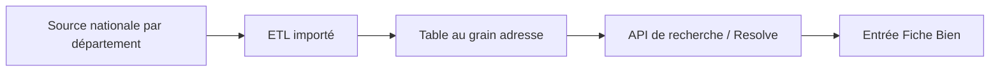

# Matrice des 27 datasets — audit de recentrage du 10 septembre 2026

## Portée

Cette matrice est un inventaire de navigation du code intégré `3394395a`, fondé sur le `Dataset Map` de `CLAUDE.md`, les configurations ETL, les routeurs API et les mappers frontend ciblés. Ce n'est pas 27 audits de données, ni une preuve de fraîcheur des sources terrain. « Disponible par API » signifie qu'un routeur existe ; cela ne signifie pas qu'un écran cœur l'expose correctement, ni que le stock public a été vérifié aujourd'hui.

La validation fraîche du 10 septembre est bornée : la chaîne DPE a obtenu HTTP 200 sur 16 adresses, avec 32 requêtes aux datasets ADEME et une pagination de 114 éléments sur 6 pages vérifiée. Les cinq champs comparés correspondent pour 157 projections documentaires ; cela ne prouve pas l'identité physique des logements. Les travaux 59.1/60 conservent leurs preuves datées de CI et de préproduction pour les indicateurs Commune, DVF/DPE et le comparateur. Aucun autre dataset ci-dessous n'a été retesté isolément aujourd'hui ; la présence de code, d'une table ou d'une ancienne preuve ne doit pas être transformée en validation actuelle.

## Schémas de pipeline par grain

Chaque ligne de la matrice renvoie à l'un de ces groupes. Ils décrivent la forme générale ; les clés et limites propres au dataset restent dans la table.

### G1 — adresse

### G2 — parcelle, bâtiment, mutation ou objet localisé

### G3 — commune et millésime

### G4 — proxy externe à la requête

## Matrice

| Dataset | Source déclarée dans le dépôt | Mode / stockage / API | Grain et clés utiles | Usage produit constaté | Validation fraîche au 10/09 |
|---|---|---|---|---|---|
| antennes | ANFR, fichier importé par `etl_antennes` | ETL → `antennes` → `/v1/antennes` ; **G2** | antenne/site, `code_insee`, coordonnées | API dataset et métadonnées marketing ; pas de bloc cœur Fiche actuel identifié dans cet audit | **Non testé aujourd'hui** |
| ban | Base Adresse Nationale, `adresse.data.gouv.fr` | ETL départemental → `adresses` → `/v1/geocode`, `/v1/reverse` et Resolve ; **G1** | adresse, `ban_id`, `code_commune`, point | autocomplete, résolution et entrée Fiche Bien | Couvert indirectement par les 16 résolutions DPE HTTP 200 ; exhaustivité BAN non auditée |
| batiments | IGN BD TOPO | ETL → `batiments` → `/v1/batiments` ; **G2** | bâtiment géométrique, point ; pas une identité RNB | API/Resolve générique ; ne suffit pas à prouver le bâtiment d'une adresse | **Non testé aujourd'hui** |
| cadastre | Etalab Cadastre, GeoJSON départemental | ETL → `parcelles` → `/v1/parcelle` et Resolve ; **G2** | parcelle, `id_parcelle`, `commune`, géométrie | parcelle canonique et Fiche Bien | Utilisé dans les parcours DPE en cours ; exactitude cadastrale terrain **non qualifiée séparément** aujourd'hui |
| connectivite | ARCEP « Ma connexion internet » | ETL → `eligibilite_fixe` → `/v1/connectivite` ; **G2** | immeuble/adresse réseau, `id_imb`, `code_insee`, voie/numéro | API dataset et catalogue ; pas d'écran cœur vérifié ici | **Non testé aujourd'hui** |
| copropriete | Registre national des copropriétés, ressource configurée par `etl_copropriete` | ETL → `copropriete` → `/v1/copropriete` ; **G2** | copropriété/parcelle, `code_insee_parcelle_1`, référence parcellaire | API dataset et agrégats communaux historiques ; écran cœur non qualifié ici | **Non testé aujourd'hui** |
| demographie | INSEE, populations et logements | ETL multi-fichiers → `demographie` → `/v1/demographie` ; **G3** | commune × millésime, `code_insee` | Fiche Commune, contexte communal de Fiche Bien, comparateur | Rendu consommateur inclus dans la préproduction 59.1/60 ; fraîcheur source complète non réauditée aujourd'hui |
| dpe | ADEME, fichiers DPE existant/neuf | ETL → `diagnostics_dpe` → `/v1/dpe`, inventaire et Resolve ; groupes **G1/G2** | diagnostic, identifiant DPE, clé BAN déclarée ; identité logement non déduite | Fiche Bien, inventaire à l'adresse, indicateurs communaux | **16 adresses HTTP 200, 32 requêtes ADEME, 114 éléments/6 pages vérifiés ; parité sur les champs testés, aucune certification d'identité logement** |
| dvf | DGFiP / fichiers Geo-DVF `data.gouv.fr` | ETL → `mutations` + `mutations_grain`/`mutation_parcelles` → `/v1/dvf` et Resolve ; **G2/G3** | mutation `id_mutation` ↔ une ou plusieurs `id_parcelle`; agrégats commune × fenêtre | Fiche Bien au grain mutation/parcelle, Fiche Commune, comparateur | Indicateurs et paire réelle qualifiés en préproduction 59.1/60 ; aucune nouvelle validation production aujourd'hui |
| encadrement_loyers | DRIHL / `data.gouv.fr` | ETL → `encadrement_loyers` → `/v1/encadrement-loyers` ; **G2** | zone/quartier géographique, `code_insee_quartier` | API dataset et catalogue ; non raccordé au cœur vérifié ici | **Non testé aujourd'hui** |
| equipements | INSEE BPE | ETL → `equipements` → `/v1/equipements` ; **G2/G3** | équipement localisé, catégorie, commune | synthèse/présentation communale selon contrat historique, API dataset | **Non testé aujourd'hui** |
| fiscalite | Fiscalité locale des particuliers, ressource `data.gouv.fr` | ETL → `fiscalite_locale` → `/v1/fiscalite` ; **G3** | commune × année, `code_insee` | Fiche Commune et contexte communal | Rendu global 59.1 potentiellement consommateur ; dataset isolé **non retesté aujourd'hui** |
| foncier_pm | Fichiers fonciers des personnes morales, data.economie.gouv.fr via data.gouv.fr | ETL → `foncier_pm` → `/v1/foncier-pm` ; **G2** | parcelle/propriétaire personne morale ; clés cadastrales de source | API ; aucune surface frontend déclarée dans le Dataset Map | **Non testé aujourd'hui** |
| loyers | Indicateurs de loyers, source configurée dans `etl_loyers` | ETL → `indicateurs_loyers` → `/v1/loyers` ; **G3** | commune/type × millésime, `code_insee` | Fiche Commune, contexte de marché de la Fiche Bien, comparateur selon grille | Contrat consommé par les fiches, mais dataset isolé et fraîcheur source **non testés aujourd'hui** |
| monuments | POP / monuments historiques, ressource importée par `etl_monuments` | ETL → `monuments_historiques` → `/v1/monuments` ; **G2/G3** | monument localisé, `code_insee` lors de la protection | API dataset, contexte environnement/patrimoine selon présentation | **Non testé aujourd'hui** |
| permis | Sitadel / ressource `data.gouv.fr` configurée par `etl_permis` | ETL → `permis` → `/v1/permis` ; **G2/G3** | autorisation d'urbanisme, commune et localisation disponible | API dataset et catalogue ; distinct du proxy GPU de règles d'urbanisme | **Non testé aujourd'hui** |
| revenus | INSEE Filosofi, fichier statistique | ETL → `revenus` → `/v1/revenus` ; **G3** | commune × année, `code_insee` | Fiche Commune, contexte de Fiche Bien, comparateur | Valeurs et périodes présentes dans la recette 59.1/60 ; source complète **non retestée aujourd'hui** |
| scolaire | Carte scolaire des collèges publics, `data.gouv.fr` | ETL → `carte_scolaire` → `/v1/scolaire` ; **G2/G3** | établissement/secteur, `code_rne`, `code_insee` | API dataset et catalogue ; pas de fonctionnalité cœur qualifiée ici | **Non testé aujourd'hui** |
| transport | transport.data.gouv.fr et miroir SNCF data.gouv.fr | ETL → `arrets_transport` → `/v1/transports` ; **G2** | arrêt/gare, coordonnées, `code_insee`, ligne | API dataset et catalogue ; pas d'écran cœur qualifié ici | **Non testé aujourd'hui** |
| vacance | LOVAC, ressource `data.gouv.fr` | ETL → `vacance` → `/v1/vacance` ; **G3** | commune × année, `code_insee` | Fiche Commune et contexte de propriété/logement | Contrat de rendu communal couvert par preuves antérieures ; **non retesté aujourd'hui** |
| zonage_abc | Zonage ABC, ressource `data.gouv.fr` | ETL → `zonage_abc` → `/v1/zonage-abc` ; **G3** | commune × version, `code_insee` | Fiche Commune et contexte marché/risques selon mapper | **Non testé aujourd'hui** |
| bdnb | API BDNB | proxy `/v1/bdnb`, sans table ETL ; **G4** | bâtiment demandé par clé BAN | API et enrichissement Resolve disponible ; aucun écran cœur livré/qualifié dans cet audit | **Non testé aujourd'hui** |
| errial | API ERRIAL Géorisques | proxy `/v1/errial`, sans table ETL ; **G4** | point → code INSEE + parcelle formatée → avis | API disponible ; distinct du bloc risques de la Fiche Bien | **Non testé aujourd'hui** |
| georisques | API Géorisques | proxys `/v1/risques`, `/v1/pollutions` et dataset Resolve `risques` ; **G4** | point pour argiles/pollutions, `code_insee` pour risques communaux | bloc Risques de la Fiche Bien ; réponses externes isolées du chargement principal | **Non testé aujourd'hui** |
| rnb | API RNB | proxy `/v1/rnb`, sans table métier principale ; **G4** | `rnb_id` ou coordonnées | API disponible ; la relation écran BAN↔bâtiment utilise plutôt la table locale `rnb_liens` alimentée séparément | **Non testé aujourd'hui** |
| sirene | API INSEE Sirene | proxy `/v1/entreprises`, sans ETL local déclaré ; **G4** | établissement/entreprise, SIRET/SIREN et localisation | API/Resolve générique ; pas de fonctionnalité cœur qualifiée ici | **Non testé aujourd'hui** |
| urbanisme | API Carto GPU de l'IGN | proxy `/v1/urbanisme` et dataset Resolve `urbanisme` ; **G4** | point géographique → zonage/règles | bloc Urbanisme différé de la Fiche Bien | **Non testé aujourd'hui** |

## Ce que la matrice ne permet pas de conclure

- Une route et un pipeline présents ne prouvent ni un stock complet en 44/85, ni son millésime, ni sa fidélité au producteur.
- Une donnée présente dans `/v1/commune` ne prouve pas qu'elle est lisible dans la Fiche Commune ou comparable entre deux communes.
- Un proxy disponible peut échouer selon l'amont ; son écran doit rendre cette indisponibilité sans masquer les autres datasets.
- Les relations par point sont des recherches spatiales ; les relations par `ban_id`, `id_parcelle`, `id_rnb` ou `id_mutation` ont des cardinalités différentes et ne doivent pas être présentées comme interchangeables.

## Surfaces hors cœur

Le catalogue datasets, la référence API, le playground, les routes développeur et les CTA de prospection existent dans le frontend, mais ils ne remplacent pas les parcours cœur adresse, fiche, comparaison et export. La passe de contenus et de méthode prévue en phase 61 n'est pas démarrée. La présence d'un CTA de prospection ne constitue donc ni une fonctionnalité métier qualifiée, ni une validation de ces 27 chaînes.

## Recette à rattacher au plan de récupération

Pour chaque dataset réellement retenu dans un écran cœur, le futur reçu doit identifier : source et millésime, nombre d'objets d'entrée, clé de jointure, cardinalité observée, réponse API exacte, emplacement dans l'écran, état d'absence/panne et verdict de lisibilité. Les datasets seulement exposés par API peuvent rester dans un lot développeur distinct ; ils ne doivent pas gonfler artificiellement la promesse utilisateur des Fiches.
