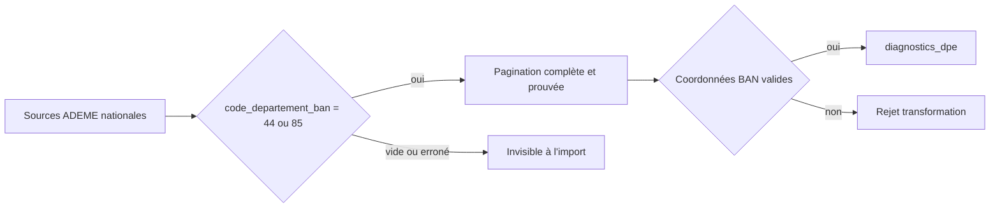
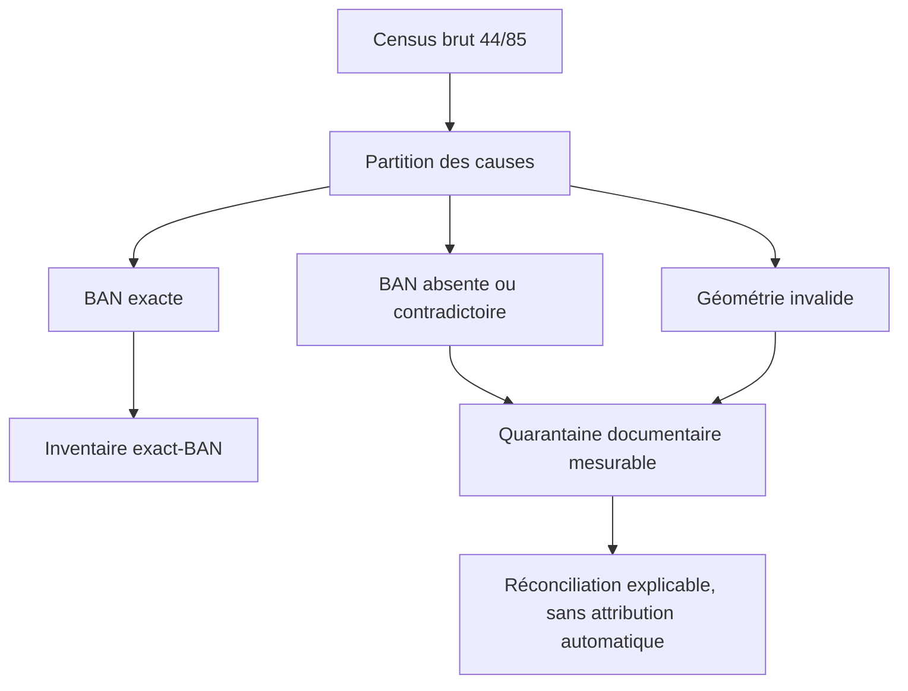
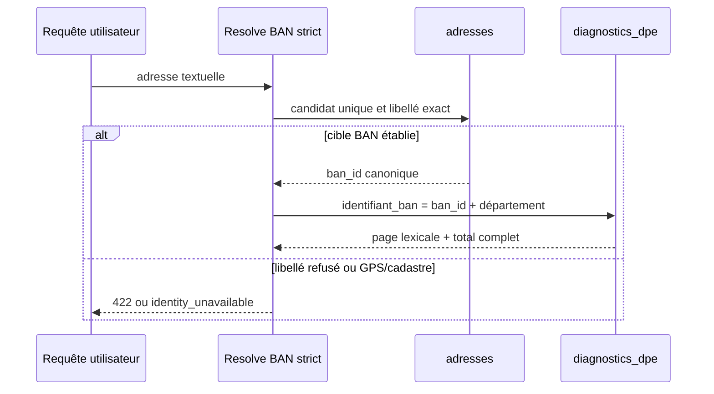
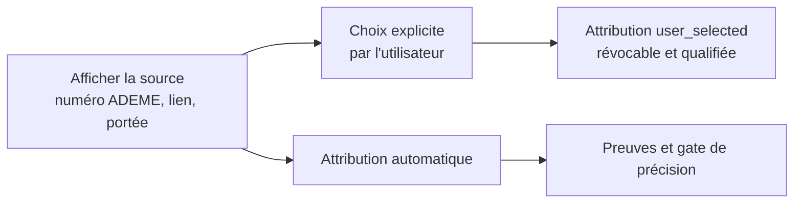

# Audit ciblé DPE — code intégré `3394395a`

Date : 2026-09-10. Audit en lecture seule du checkout
`C:/tmp/datacommune-phase591-20260910`. Le présent document distingue les faits
de code, les observations déjà mesurées et les changements proposés. Il ne
revendique aucun test exécuté pendant cet audit, aucune donnée de production
nouvelle et aucun déploiement.

## Verdict

Le système actuel est cohérent avec une doctrine très prudente : il publie un
**inventaire documentaire à une adresse BAN**, jamais le DPE du logement. Cela
explique directement pourquoi toute adresse avec au moins un document reçoit
`unassigned / dwelling_identity_unproven`, y compris lorsqu'un seul document
reste valide et non remplacé. Ce n'est pas un bug accidentel de sélection : la
non-attribution est codée comme invariant.

Deux défauts de produit subsistent autour de cet invariant :

1. la « couverture source » est bornée par `code_departement_ban`, donc par le
   résultat du géocodage ADEME. Elle ne mesure pas les DPE des départements 44/85
   dont ce champ est absent ou erroné ;
2. une cible SQL positive peut devenir une absence côté `/resolve` lorsque le
   libellé saisi ne passe pas la sélection BAN stricte. La mesure existante en a
   trouvé 9 sur 21 cibles source.

L'action prioritaire est de rendre le diagnostic source identifiable et vérifiable,
puis de permettre son choix explicite, sans le choisir automatiquement parce qu'il
est « le plus récent ». Il faut aussi séparer trois états aujourd'hui confondables :
adresse non résolue, inventaire exact-BAN vide, et DPE source hors périmètre du
géocodage BAN. L'attribution automatique précise constitue un troisième niveau,
plus exigeant que la consultation ou le choix assumé par l'utilisateur.

## 1. Acquisition et couverture réelle

### Faits observés dans le code

- L'import ferme son univers à deux sources ADEME, `dpe03existant` et
  `dpe02neuf`, et deux départements, 44 et 85
  (`api/backend/app/etl_dpe/config.py:8-11`, `:67-68`).
- Pour chaque couple source × département, la requête distante utilise
  exclusivement `code_departement_ban:"{department}"`
  (`api/backend/app/etl_dpe/sources.py:58-61`). Les comptages et chaque page
  réutilisent ce filtre (`api/backend/app/etl_dpe/pipeline.py:495-513`,
  `:527-535`). Autrement dit, le périmètre est « lignes que l'ADEME a déjà
  affectées au département par BAN », et non « tous les DPE dont l'adresse brute
  appartient au département ».
- Les champs bruts (`adresse_brut`, `code_postal_brut`, commune) sont bien
  téléchargés, mais seulement **après** ce filtre. Ils ne peuvent donc pas
  récupérer les lignes éliminées en amont (`api/backend/app/etl_dpe/config.py:51-60`).
- La pagination distante est robuste dans ce périmètre : tri stable par
  `numero_dpe`, curseur `after`, détection de répétition/page vide, preuve de
  terminaison et égalité `initial_total = final_total = rows`
  (`api/backend/app/etl_dpe/pipeline.py:522-561` ;
  `api/backend/app/etl_dpe/sources.py:254-278`, `:345-369`).
- La transformation abandonne toute ligne sans coordonnées BAN valides, avant
  publication (`api/backend/app/etl_dpe/pipeline.py:637-659`). Une mesure ciblée
  antérieure conclut toutefois que les 144 nouvelles géométries invalides ne
  portaient aucune identité BAN exacte exploitable ; ce filtre n'expliquait donc
  aucun gain récupérable dans ce lot
  (suivi interne : `58.2-04-SUMMARY.md:27-32`).

### Données déjà acquises

Après l'import local 58.2, le corpus passe de 474 604 à 540 717 numéros DPE
distincts ; 540 654 restent descriptifs. Les adresses BAN joignantes avec un
document descriptif passent de 180 529 à 194 342, soit +13 814 gains, 1 perte et
+13 813 net
(suivi interne : `58.2-MESURE-APRES.md:74-81`).
Ces chiffres démontrent un gain dans l'univers filtré. Ils ne donnent pas le
dénominateur des DPE 44/85 avant géocodage BAN.

La mesure « forme de clé » rapporte zéro `sans_cle` pour les maisons des deux
départements (`58-MESURE-DPE-MAISON.md:11-22`). C'est attendu puisque la collecte
était déjà filtrée par `code_departement_ban`; ce zéro ne prouve pas que la source
nationale ne contient aucun DPE sans clé BAN exploitable.

### Correction proposée

Ajouter un **census source indépendant de l'import**, fondé sur les champs bruts
(`code_postal_brut`, commune brute et, si disponible, code INSEE brut), et publier
les populations suivantes par source et département : total brut éligible,
`code_departement_ban` correct, BAN absent, BAN d'un autre département,
coordonnées invalides, importé, tombstone. Ce census doit avoir son propre hash de
source et ne doit pas modifier automatiquement l'identité des documents.

Le rattrapage éventuel doit conserver deux grains : document source sans identité
adresse, puis document relié à une adresse seulement après preuve. Une géométrie
ou un texte voisin ne doit pas devenir une clé BAN silencieuse.

## 2. Résolution et lecture exact-BAN

### Faits observés dans le code

- Une requête adresse ne retient une cible que si le numéro, la voie, la commune
  ou le code postal normalisés correspondent exactement et si une seule ligne
  concorde. Plus de 20 candidats ou zéro/plusieurs concordances produit un 422
  « Adresse à préciser » (`api/backend/app/resolve/address_selection.py:36-81`).
- Seul le mode `adresse` transmet `base.ban_id` au DPE. GPS et cadastre forcent
  `canonical_dpe_ban_id = None` (`api/backend/app/resolve/router.py:366-378`).
- L'inventaire retrouve d'abord l'adresse par égalité
  `adresses.ban_id = :ban_id` et département (`api/backend/app/dpe/queries.py:257-282`),
  puis les documents par égalité
  `diagnostics_dpe.identifiant_ban = :ban_id` et même département
  (`api/backend/app/dpe/queries.py:339-372`). Aucun rayon, texte, score BAN ou RNB
  n'entre dans cet inventaire.
- La première page utilise une pagination keyset `(numero_dpe, id)` et une ligne
  sentinelle `limit + 1`; le total et la distribution sont calculés séparément sur
  l'inventaire complet (`api/backend/app/dpe/queries.py:339-443`). C'est correct
  pour l'exhaustivité du total.
- La page inclut les tombstones dans `total` et dans les items ; la distribution
  les verse en `unknown`, tandis que `apartment_document_count` les exclut
  (`api/backend/app/dpe/queries.py:384-425`). Ce choix conserve la trace de retrait,
  mais `total` signifie donc « documents ou traces », pas « DPE actifs ».
- L'ordre public est lexical par `numero_dpe`, sans sens chronologique
  (`api/backend/app/dpe/queries.py:355-367`). La consultation d'un document se fait
  par une référence signée liée au contexte, puis relit exactement `id + ban_id +
  department` (`api/backend/app/dpe/inventory_service.py:523-580`). Il n'existe pas
  de « document sélectionné » par défaut.

### Cause concrète des faux « absents » de parcours

La mesure après import a rejoué 21 cibles source : SQL trouvait 21 adresses et 279
descriptifs, mais HTTP n'a exposé que 12 inventaires ; les 9 autres requêtes ont
échoué à la résolution car leur libellé gelé différait du libellé BAN, même après
normalisation (`58.2-MESURE-APRES.md:146-165`). Ce ne sont ni des inventaires vides
ni une absence DPE. La chaîne doit conserver cette distinction jusqu'à l'UI.

### Correction proposée

Rendre observable un état séparé `address_resolution_failed` avec le nombre borné
de candidats et un identifiant de cas non sensible. Pour les parcours interactifs,
permettre à l'utilisateur de sélectionner explicitement une proposition BAN ; la
clé sélectionnée devient alors canonique. Ne jamais transformer ce cas en
`not_reported`.

Clarifier aussi les compteurs publics : `trace_count`, `active_document_count`,
`expired_count`, `replaced_count`, `unknown_lifecycle_count`. Garder `total` pour
compatibilité si nécessaire, mais définir son grain dans le schéma.

## 3. Cycle de vie : valide, récent et remplacé

### Faits observés dans le code

- La réconciliation garde une ligne par `numero_dpe`. Un document disparu des
  quatre couples source × département devient une tombstone minimale avec
  `source_state = absent_from_complete_scope`; il n'est pas supprimé
  (`api/backend/app/etl_dpe/reconciliation.py:355-386`, `:406-461`).
- Le graphe global utilise uniquement `numero_dpe_remplace`. Il détecte doublons,
  cibles manquantes, cycles, fourches et composants trop grands. Un document est
  `replaced` seulement lorsqu'un successeur explicite est connu
  (`api/backend/app/dpe/lifecycle.py:83-145`).
- La validité calendaire est évaluée à la lecture à partir des dates source, avec
  états séparés expiré, futur et dates incohérentes
  (`api/backend/app/dpe/lifecycle.py:156-181`).
- Ni « valide » ni « dernier par date » ne filtre la page d'inventaire. Le détail
  affiche la validité, mais ne promeut aucun document
  (`api/backend/app/dpe/inventory_service.py:550-579`).

Conclusion : le code sait dire « remplacé » et « non expiré par date », mais il ne
définit volontairement aucun « DPE courant du logement ». Choisir le maximum de
`date_etablissement_dpe` serait faux lorsque plusieurs logements partagent une
adresse ou lorsque le graphe est incomplet.

## 4. Pourquoi l'attribution est toujours `unassigned`

### Fait de code déterminant

`_dpe_decision_from_inventory()` retourne systématiquement
`unassigned / dwelling_identity_unproven` pour tout inventaire `ready`
(`api/backend/app/resolve/multi.py:210-237`). Le moteur historique confirme cette
doctrine : dès qu'une ligne exact-BAN existe, le résultat est `unassigned`, sans
branche positive (`api/backend/app/dpe/attribution.py:80-119`).

Le module d'appariement 58.3 compare seulement type et surface. Il ajoute des
blockers de couverture, cycle de vie et pagination, puis reconstruit encore une
attribution `unassigned` (`api/backend/app/dpe/matching.py:15-75`, `:78-127`,
`:149-166`). La surface n'a aucun seuil calibré ; une égalité exacte vaut
`matching`, tout autre écart reste simplement `known` (`:68-75`, `:144-146`).

### Obstacle produit : le document n'est pas vérifiable

Le modèle `DpeConsultedDocument` expose les caractéristiques énergétiques mais
retire `numero_dpe`, `adresse_brut`, `adresse_ban`,
`numero_etage_appartement`, `complement_adresse_logement` et `id_rnb`
(`api/backend/app/dpe/schemas.py:473-494`). Le SQL possède pourtant le numéro DPE
et le complément logement (`api/backend/app/dpe/queries.py:64-89`, `:113-154`),
puis les omet lors de la projection publique
(`api/backend/app/dpe/inventory_service.py:557-580`).

Le frontend reproduit la restriction : ses types ne connaissent que la référence
opaque, le type, la surface, les classes et les dates
(`frontend/src/lib/api/dpe-inventory.ts:62-111`), et son projecteur reconstruit le
même sous-ensemble (`:595-634`). La liste affiche « Document 01 », type, surface,
date et classe (`frontend/src/lib/components/fiche/DpeInventory.svelte:91-141`).
L'aperçu de matching affiche lui aussi « Document 01 » et ne compare que type et
surface (`frontend/src/lib/components/fiche/DpeMatchingPreview.svelte:150-232`).

Le client ne peut donc ni rechercher le diagnostic ADEME par son numéro officiel,
ni distinguer deux appartements par étage/porte/complément, ni comprendre une
discordance entre adresse brute et adresse BAN. La référence opaque protège la
navigation interne, mais ne fournit aucune référence documentaire vérifiable.

Cette suppression n'est pas une obligation légale établie dans les artefacts lus.
Elle vient d'arbitrages de phase : le contexte exclut numéro ADEME, BAN, adresse
brute et étage (`58.1-CONTEXT.md:36-48`) ; le plan frontend interdit le choix et
impose les documents opaques (`58.1-03-PLAN.md:92-101`). Ces décisions protégeaient
contre une attribution silencieuse et la fuite de corpus privé. Elles doivent être
réexaminées champ par champ ; elles ne rendent pas nécessairement confidentielle
une référence publique ADEME destinée à identifier un diagnostic.

### Trois niveaux à distinguer

1. **Afficher un document source connu.** Aucun modèle probabiliste n'est requis :
   publier son numéro DPE, un lien officiel sûr, ses caractéristiques et la portée
   « document rattaché à cette adresse BAN ».
2. **Permettre un choix utilisateur.** Afficher étage/complément utiles après
   minimisation, et les adresses ADEME brute/BAN dans un panneau de preuve. Nommer
   le résultat « diagnostic sélectionné par l'utilisateur », le dater et permettre
   son retrait ; ce n'est pas une vérité ADEME supplémentaire.
3. **Attribuer automatiquement.** Ce niveau seul exige une calibration et une
   mesure de précision ; il ne doit pas bloquer les deux premiers.

### Observations fraîches communiquées pour cet audit

| Cas | Source ADEME | DataCommune | Attente produit |
|---|---|---|---|
| R06 — 105 Aristide-Briand, Rezé | unique `2644E0008262R`, 79 m², D | inventaire 1, `unassigned` | afficher référence et lien ADEME ; permettre au client de reconnaître et sélectionner le document |
| R09 — 111 Carterons | `2644E0031728F`, brut 111, BAN 113 | résolution 111, inventaire 0 | signaler la discordance 111→113 et proposer un contrôle du document source, jamais conclure « aucun DPE » |
| R11 — 38 Alexandre-Huchon | `2244E0138923Y`, BAN 21 Chupiet | résolution 38, inventaire 0 | signaler l'association BAN contradictoire et rendre le document vérifiable |

R06 montre qu'un document exact-BAN unique peut être utilement affiché sans
attendre un corpus probabiliste. R09 et R11 montrent que l'égalité BAN protège
contre le voisin, mais transforme une erreur de géocodage source en inventaire
vide. Le rattrapage doit rester une voie séparée, explicable et confirmable.

### Prérequis réels pour une attribution automatique positive

Une branche automatique `assigned_auto` ne devrait être ajoutée qu'après
acquisition simultanée de :

1. une identité logement indépendante de l'adresse (identifiant logement fiable,
   référence de lot, ou autre clé officielle stable) **ou**, à défaut, un corpus
   annoté permettant de calibrer un appariement probabiliste ;
2. l'inventaire complet, toutes pages incluses, sans candidat hors page ;
3. un document présent, non tombstone, non expiré, non remplacé, avec graphe sans
   cycle/fourche/cible manquante ;
4. des attributs comparables : type de bien prouvé, surface de même nature
   `habitable_dpe`, étage/complément normalisés lorsque disponibles ;
5. un candidat unique après règles calibrées, et aucun concurrent compatible ;
6. une précision mesurée sur un jeu de validation réservé, stratifié maisons /
   appartements, 44/85, adresse mono/multi-logements et cas de remplacement.

Sans vérité logement indépendante, l'auto-attribution reste invérifiable. Cela
n'empêche ni de publier le document ADEME, ni de proposer des candidats expliqués,
ni d'enregistrer un choix explicitement déclaré par l'utilisateur.

## 5. Plan correctif ordonné et tests d'acceptation proposés

### P0 — rendre les absences honnêtes

- Ajouter le census source pré-BAN et les compteurs de pertes par cause.
- Propager trois états distincts : résolution adresse échouée, inventaire exact-BAN
  vide, source hors couverture/indéterminée.
- Afficher explicitement « inventaire à l'adresse » et séparer traces, documents
  actifs, expirés et remplacés.
- Ajouter `numero_dpe` au détail public, un lien vers la source officielle et la
  portée exacte de l'association. Réexaminer séparément adresse brute, adresse BAN,
  étage, complément et RNB selon leur utilité et leur risque concret, plutôt que
  les interdire comme un bloc indivisible.

Tests proposés :

- fixture source 44 avec `code_postal_brut=44xxx` et
  `code_departement_ban` vide : comptée dans le census brut et dans la perte BAN,
  jamais dans « source absente » ;
- fixture avec BAN département erroné : détectée comme contradiction, jamais
  importée silencieusement dans l'autre département ;
- cible SQL positive dont le libellé saisi diverge : réponse de résolution typée,
  jamais `dpe.not_reported` ; après sélection explicite de la proposition BAN, le
  même inventaire exact est servi ;
- erreur/timeout ADEME ou DB : `unavailable`, jamais inventaire vide.
- R06 : le détail contient `2644E0008262R`, 79 m² et D, avec lien source et
  libellé « diagnostic connu à cette adresse », sans auto-attribution implicite ;
- R09/R11 : l'inventaire exact-BAN reste vide, mais un état de discordance expose
  la référence source et les adresses nécessaires au contrôle, sans les présenter
  comme diagnostic du logement.

### P1 — fermer les compteurs et le cycle de vie

- Exposer les compteurs de cycle de vie sans élire de document.
- Conserver la pagination keyset et vérifier les invariants sur toutes les pages.

Tests proposés :

- 121 documents, limite 120 : `total=121`, `has_more=true`, page 2 sans doublon ni
  omission ; insertion concurrente exclue par le snapshot transactionnel ;
- chaîne A remplacé par B, B expiré : A=`replaced`, B=`expired`, aucun « courant » ;
- fourche, cycle et cible absente : graphe incohérent et aucune attribution ;
- tombstone : visible comme trace, absente de `active_document_count` et de la
  distribution A-G active.

### P2 — candidats explicables puis attribution calibrée

- Étendre la comparaison à l'étage/complément seulement après normalisation
  mesurée ; charger toutes les pages avant toute unicité ; publier le détail des
  critères et blockers.
- Ajouter d'abord une action explicite « C'est mon diagnostic » avec provenance
  `user_selected`, date, possibilité de retrait et réserve visible. Ce choix ne
  modifie pas les faits ADEME et ne constitue pas une auto-attribution.
- Pour l'auto-attribution seulement, construire le corpus annoté indépendant,
  geler les règles et seuils avant le jeu réservé. N'activer `assigned_auto` que
  si le gate de précision convenu passe avec des effectifs publiés.

Tests proposés :

- maison mono-adresse, un seul terminal valide : document source affiché et
  sélectionnable ; avec identité logement indépendante concordante, cas minimal
  d'auto-attribution positive ;
- appartement multi-logements, deux surfaces/types compatibles : `unassigned` ;
- candidat compatible en page 2 : la page 1 seule ne peut jamais produire un
  positif ;
- document le plus récent mais remplacé/incompatible : jamais sélectionné ;
- voisin spatial ou autre clé BAN du même RNB : contexte bâtiment seulement,
  jamais candidat logement.

## Limites de cet audit

Les nombres cités proviennent des artefacts mesurés existants, pas d'une nouvelle
requête live. Les 21 cibles sont un lot ciblé et les 40 adresses générales ne sont
pas représentatives de toute la population. Aucun taux de précision d'attribution
n'est calculable tant qu'un corpus de vérité logement indépendant n'existe pas.
