# Audit fonctionnel hors DPE — 10 septembre 2026

## Portée et lecture des preuves

Cet audit décrit le code intégré du worktree `C:/tmp/datacommune-phase591-20260910` au commit `3394395a`. Il ne décrit pas l'ancien état documentaire du dépôt racine et ne vaut ni observation fraîche de production, ni validation utilisateur. Les preuves de préproduction et de CI citées sont celles déjà enregistrées par les phases 59.1 et 60. Le retour utilisateur actuel — interface rejetée malgré des contrôles techniques verts — impose une nouvelle recette centrée sur les tâches, les libellés et la compréhension des grains.

## Clés communes et grains réellement portés

| Clé | Grain dans le code | Relations supportées | Limite à montrer dans l'interface |
|---|---|---|---|
| `code_insee` | commune | BAN → commune ; résolution → synthèse communale ; comparateur → deux synthèses | Une valeur communale ne décrit pas le bien. |
| `ban_id` / clé BAN | adresse sélectionnée | adresse → DPE documentaire ; adresse + parcelle → porteurs RNB | Une clé BAN identifie une adresse, pas un logement ni un bâtiment unique. |
| `id_parcelle` | parcelle cadastrale | résolution géographique → cadastre ; `mutation_parcelles` → mutations DVF ; liens RNB → bâtiments présents sur la parcelle | Une parcelle peut porter plusieurs bâtiments, adresses, logements et mutations. |
| `id_rnb` | bâtiment RNB | `rnb_liens` relie un bâtiment à ses clés BAN et parcelles | Le code accepte plusieurs porteurs d'une même clé BAN ; il ne faut pas présenter « le bâtiment » sans preuve d'unicité. |
| `id_mutation` | mutation DVF | mutation complète ↔ une ou plusieurs parcelles | Une mutation peut couvrir plusieurs locaux et parcelles ; ce n'est pas l'identifiant d'un logement. |
| identifiant DPE | diagnostic documentaire | diagnostic ↔ clé BAN déclarée par la source | Détaillé dans l'audit DPE séparé ; il ne doit pas servir de raccourci d'identité logement.

Preuves de code : résolution de la parcelle et conservation des candidats dans `api/backend/app/resolve/router.py:127-168` ; jointure DVF exacte par `mutation_parcelles` dans `api/backend/app/dvf/queries.py:310-346` ; porteurs RNB et autres clés BAN dans `api/backend/app/logements/queries.py:128-230` ; synthèse à une ligne par commune dans `api/backend/app/commune/queries.py:16-28`.

## 1. Rechercher une adresse

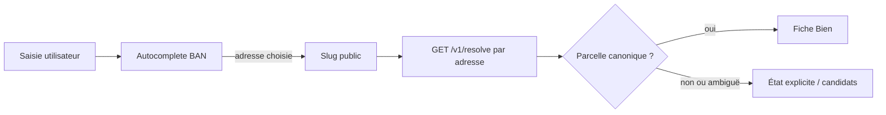

**Implémenté.** La page `/bien` utilise `AdresseAutocomplete`, puis navigue avec un slug de libellé (`frontend/src/routes/(marketing)/bien/+page.svelte:16-31`). Le backend refuse qu'une commune ou une rue seule identifie un bien et exige une sélection d'adresse (`api/backend/app/resolve/address_selection.py:14-63`). La résolution cherche la parcelle au point puis peut proposer des parcelles proches dans un ordre stable (`api/backend/app/resolve/router.py:194-231`, `148-173`).

**Problème de compréhension.** Le produit passe du libellé choisi à un slug, puis refait une résolution parce que l'URL ne porte pas d'identifiant BAN stable. L'utilisateur ne voit pas clairement si l'adresse a été reconnue exactement, si la parcelle a été déduite ou si plusieurs parcelles restent possibles.

**Réparation proposée.** Garder le parcours nominal direct : adresse strictement sélectionnée → Fiche Bien → DPE lisible immédiatement. N'afficher une étape de choix que lorsque la résolution retourne réellement plusieurs parcelles ou une identité insuffisante. Dans les autres cas, un libellé contextuel discret sous le titre suffit : adresse reconnue et, si utile au bloc consulté, parcelle concernée.

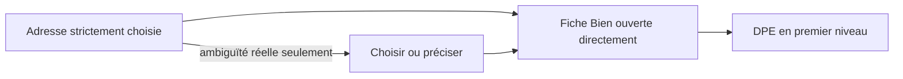

**Acceptation manquante.** Tester avec de vraies adresses 44/85 : adresse simple, angle de rue, copropriété, adresse sans parcelle, saisie rue seule et commune seule. Vérifier que l'utilisateur peut expliquer ce qui a été reconnu avant de lire les données.

## 2. Relier adresse, parcelle et bâtiment

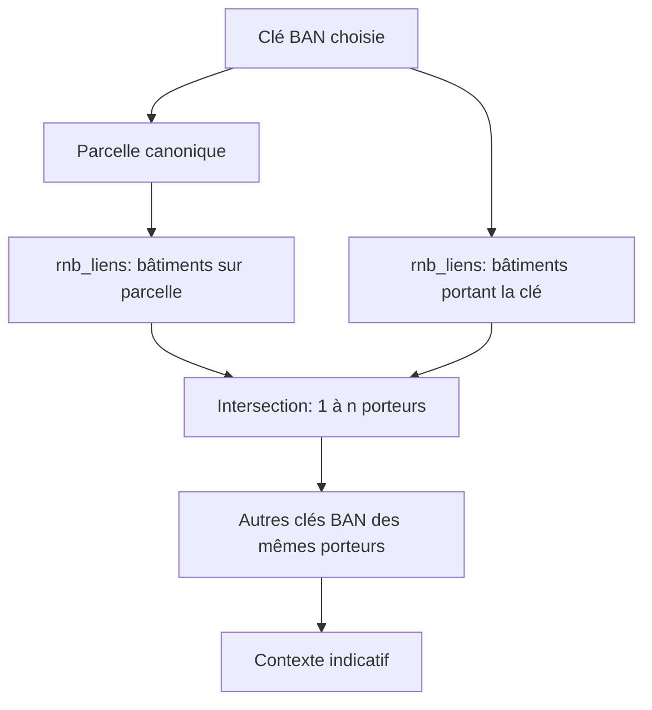

**Implémenté en contexte, pas comme identité certaine.** La requête `cles_ban_batiment_rnb` intersecte les bâtiments de la parcelle avec ceux portant la clé BAN, puis récupère leurs autres clés (`api/backend/app/logements/queries.py:140-169`). Elle documente explicitement les bâtiments d'angle, les résidences à plusieurs ailes et le plafond qui ferme l'élargissement (`api/backend/app/logements/queries.py:173-230`). La hiérarchie frontend nomme ce résultat « contexte documentaire RNB » et indique qu'il ne prouve pas une identité de bâtiment (`frontend/src/lib/data/bien-hierarchy.ts:93-109`).

**Problème de compréhension.** Le concept central est dispersé entre la fiche, un interstitiel logements, le bloc hiérarchique et le contexte RNB. Un utilisateur peut confondre la parcelle, l'adresse et le bâtiment même si chaque fonction reste prudente isolément.

**Réparation proposée.** Éviter un bloc technique permanent. Porter le grain dans les libellés là où il change : « à cette adresse », « sur cette parcelle », « bâtiment(s) associé(s) selon le RNB ». Réserver le schéma documentaire détaillé à l'aide ou au panneau « Méthode et sources ». Ne jamais utiliser le singulier « bâtiment » lorsque plusieurs porteurs existent.

**Acceptation manquante.** Recette réelle sur une maison isolée, une copropriété multi-adresses, un bâtiment d'angle et une parcelle multi-bâtiments ; l'utilisateur doit pouvoir distinguer les trois niveaux sans ouvrir les détails techniques.

## 3. Faits immobiliers : DVF, cadastre, risques et urbanisme

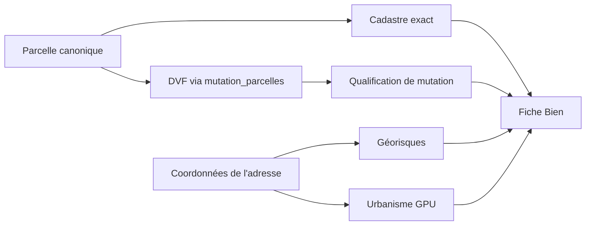

**Implémenté.** Le premier chargement demande `cadastre,dpe,dvf,commune`; les proxys lents `risques,urbanisme` sont chargés séparément (`frontend/src/lib/api/resolve.ts:499-518`). La Fiche Bien combine ensuite des lignes « sur ce bien » et « dans la commune » (`frontend/src/lib/data/bien-fiche.ts:561-637`). DVF est lu au grain mutation reliée à la parcelle, avec une décision d'attribution distincte ; le code précise qu'une mutation compatible sur la parcelle n'est pas une vente du logement (`frontend/src/lib/api/resolve.ts:340-359`). Les risques distinguent l'argile au point des risques naturels au niveau communal (`frontend/src/lib/data/bien-fiche.ts:459-514`). Le lot 59.2-01 affiche les compteurs et surfaces comme totaux de mutation et garde les mutations historiques sans montant.

**Problème de compréhension.** Le titre « Fiche Bien » et les colonnes de thèmes font cohabiter adresse, parcelle, mutation et commune. Même avec des réserves exactes, la densité et la répétition peuvent faire lire un prix DVF parcellaire ou un risque communal comme un fait propre au logement.

**Réparation proposée.** Ordonner la fiche par niveau : « À cette adresse », « Sur cette parcelle », « Dans la commune ». Pour chaque valeur, mettre le grain avant la réserve longue. Regrouper la vente récente et son périmètre dans un seul objet « mutation observée », avec compteurs de locaux/parcelles, puis reléguer l'historique. Afficher les pannes de proxys par bloc sans dégrader les données déjà chargées.

**Cible DVF et cadastre.**

**Cible risques.**

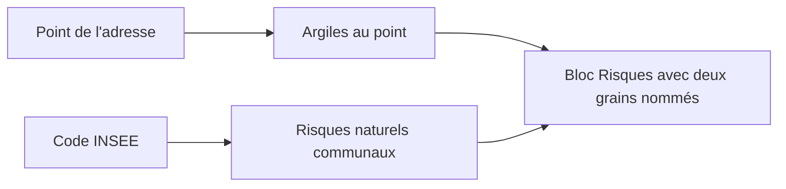

**Cible urbanisme.**

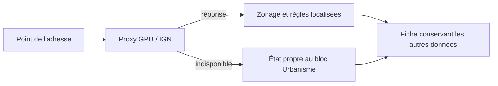

**Acceptation manquante.** Sur des réponses réelles, vérifier : cohérence de l'`id_parcelle` entre base/cadastre/DVF ; mutations multi-locales et multi-parcelles ; absence de prix individuel inventé ; distinction visuelle risque au point / risque communal ; repli indépendant lorsque Géorisques ou GPU échoue. Le verdict local 59.2-01 ne couvre ni donnée réelle, ni UAT humaine, ni publication (suivi interne : `59.2-01-VERIFICATION.md:42-46`).

## 4. Agrégats et Fiche Commune

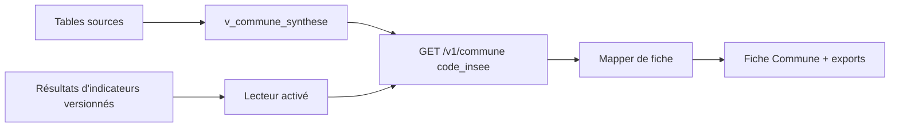

**Implémenté et qualifié sur un périmètre technique.** L'API lit une synthèse pré-calculée et ajoute les blocs d'indicateurs activés (`api/backend/app/commune/queries.py:16-113`). Le frontend transforme la réponse en fiche et réutilise la même grille dans le comparateur. La phase 59.1 a enregistré des mesures réelles et une qualification de préproduction, puis les CI du candidat commun ; elle exclut explicitement production, UAT humaine, attribution au logement et stabilité sur sept jours (suivi interne : `59.1-01-SUMMARY.md:15-33`).

**Problème de compréhension.** Les indicateurs, périodes, populations, réserves de couverture et métadonnées de génération sont techniquement disponibles, mais la page accumule synthèse, thèmes, détails et sources. Le fait que le comparateur ait ensuite compacté des métadonnées techniques confirme que leur place visuelle restait à arbitrer.

**Réparation proposée.** Concevoir la page autour de quatre questions : population et logement, marché, énergie, risques/environnement. Afficher période et population sous chaque indicateur, réserver les détails de génération à « Méthode et sources », et rendre l'absence différente de zéro. Donner à chaque thème une phrase de lecture, pas seulement un tableau.

**Acceptation manquante.** UAT humaine sur deux communes réelles aux profils différents et une commune à couverture partielle : trouver un chiffre, comprendre sa période, identifier sa source, distinguer zéro/absence et exporter sans perdre les réserves. Les contrôles de préproduction existants restent une preuve technique datée, pas une approbation de l'interface.

## 5. Comparer deux adresses

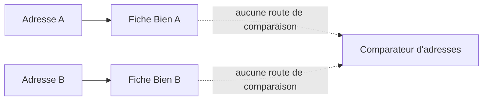

**Non implémenté comme fonctionnalité produit.** Le dépôt contient une Fiche Bien unitaire et un comparateur de communes. Aucune route de comparaison de deux biens/adresses n'apparaît dans les routes frontend, et le périmètre courant exclut le comparateur de biens. Les colonnes « logement / adresse-parcelle / commune » de la hiérarchie 59.2 comparent des grains d'une même fiche, pas deux adresses.

**Écart à planifier dans l'objectif.** Construire un comparateur de deux adresses à partir de deux résolutions indépendantes, puis comparer uniquement des faits de même grain : adresse avec adresse, parcelle avec parcelle et contexte communal avec contexte communal. Son contrat doit préciser comment traiter deux adresses partageant une parcelle ou un bâtiment et interdire toute comparaison logement ↔ mutation.

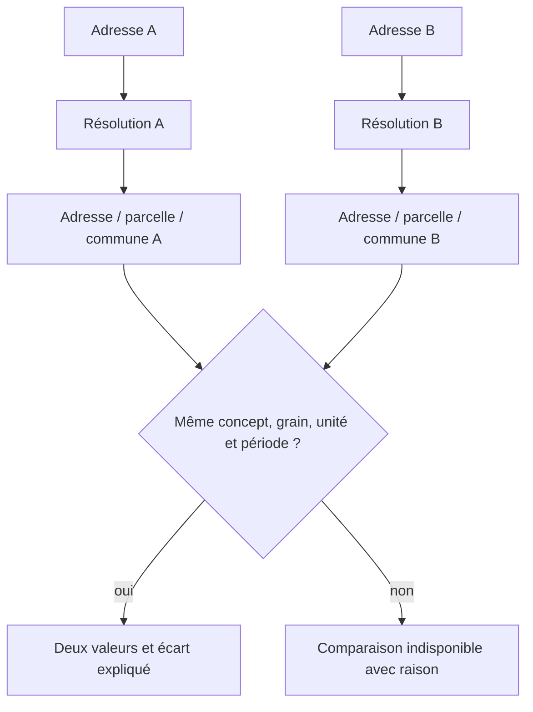

**Acceptation manquante.** Plan dédié, contrat des grains comparables, critères de confidentialité DVF et jeu de cas réels : deux maisons, deux copropriétés, deux adresses d'une même parcelle, données partielles d'un seul côté. Aucun test existant ne permet de déclarer cette fonction livrée.

## 6. Comparer deux communes

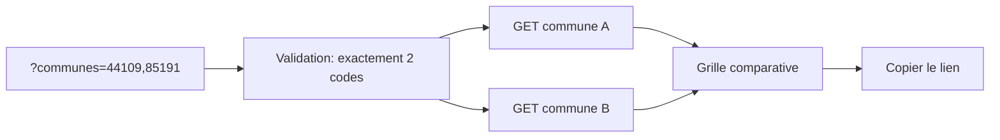

**Implémenté et vérifié en préproduction sur la paire Nantes / La Roche-sur-Yon.** La sélection est encodée dans l'URL (`frontend/src/lib/data/commune-comparison-selection.ts:13-21`), les deux synthèses sont chargées indépendamment et chaque erreur peut être retentée sans écraser l'autre (`frontend/src/lib/data/commune-comparison-load.ts:8-54`). Le comparateur propose inversion et copie du lien (`frontend/src/routes/(marketing)/comparer/+page.svelte:134-167`). La vérification courante annonce un SC5 préproduction favorable et quatre CI réussies sur le candidat commun, tout en maintenant `COMPARE-01` ouvert pour acceptation humaine et production non vérifiée (suivi interne : `60-VERIFICATION.md:31-40`).

**Problème de compréhension.** Les contrôles prouvent parité, valeurs, navigation et géométrie ; ils ne prouvent pas que l'utilisateur repère rapidement les différences utiles. La phase 60.1, qui doit porter écarts, URL stable enrichie et export comparatif, n'est pas planifiée.

**Réparation proposée.** Garder les valeurs sources inchangées, mais ouvrir par 5 à 8 écarts lisibles et expliqués, puis laisser le tableau complet dessous. Définir le sens d'un écart uniquement pour des concepts, unités, périodes et populations comparables. Ajouter un résumé partageable et un export après ce contrat.

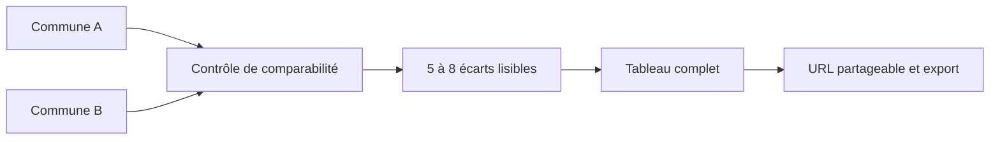

**Acceptation manquante.** UAT humaine à 375 px et desktop sur la paire qualifiée puis une paire comportant une absence partielle : sélectionner, remplacer, inverser, comprendre trois écarts, consulter les sources et partager l'URL. Vérifier la page réellement servie en production après décision de publication.

## 7. Exports

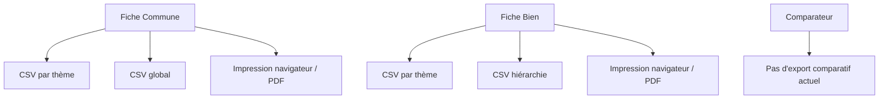

**Implémenté pour les fiches.** La commune offre CSV par thème, CSV global et `window.print()` (`frontend/src/routes/(marketing)/commune/[code]/+page.svelte:150-163`, `368-402`). La Fiche Bien offre CSV par thème, CSV de hiérarchie et impression navigateur (`frontend/src/routes/(marketing)/bien/[token]/+page.svelte:541-559`, `855-904`). Le CSV neutralise les formules et ajoute un BOM UTF-8 dans l'utilitaire partagé. Le « PDF » actuel passe par le dialogue d'impression du navigateur, pas par un générateur de document dédié ; la phase 62 reste à discuter. Le comparateur n'offre aujourd'hui que la copie du lien ; son export appartient à 60.1. Les reçus finaux du candidat `41f140a6` ont déjà contrôlé des fichiers PDF réels : 126 pages sur des documents de 14 à 23 pages, après correction d'un Nantes de 61 pages, sans perte observée (suivi interne : `59.1-VALIDATION.md:20`, `59.1-VERIFICATION.md:54`). Cette preuve datée est conservée et ne doit pas être réduite à un simple test CSS.

**Problème de compréhension.** Le libellé « Exporter en PDF » masque que le résultat dépend du navigateur. Les exports thématiques, globaux et hiérarchiques n'ont pas une promesse commune évidente sur les grains, périodes et réserves.

**Réparation proposée.** Renommer l'action actuelle « Imprimer ou enregistrer en PDF » jusqu'à la phase 62. Ajouter au début de chaque CSV : type de fiche, entité, date de consultation, grain, période, source et réserves. Définir un export comparatif seulement après le contrat d'écarts de 60.1.

**Acceptation manquante.** Ouvrir les CSV réels dans Excel/LibreOffice, vérifier accents, neutralisation des formules, zéros, absences, unités et réserves. Relire les PDF réels déjà produits sur `41f140a6` sous l'angle de la lisibilité utilisateur, puis compléter la matrice sur les navigateurs supportés et des fiches longues/partielles ; la preuve existante reste valide pour ses fichiers et ses entrées. Vérifier qu'aucun montant DVF historique ou identifiant privé retiré au SSR ne réapparaît dans un export.

## Ordre de récupération proposé

1. **Contrat de lecture commun** : rendre visibles adresse, parcelle, bâtiment, mutation et commune avec les mêmes mots partout.
2. **Parcours adresse → Fiche Bien** : ouverture directe nominale, choix seulement en cas d'ambiguïté réelle, et cas réels multi-adresses/multi-bâtiments.
3. **Fiche Bien hors DPE** : regrouper les faits par grain, puis qualifier DVF/risques/urbanisme sur données réelles.
4. **Fiche Commune** : réduire la densité, mettre période/population/source au bon niveau et faire une UAT humaine.
5. **Comparaisons** : planifier le comparateur d'adresses avec ses grains, puis enrichir le comparateur communal après preuve de comparabilité et porter URL/export dans 60.1.
6. **Exports** : harmoniser le contrat CSV et assumer l'impression navigateur jusqu'au vrai document de phase 62.

Le gate final doit associer, pour chaque parcours, une réponse réelle identifiée, le rendu réellement servi, un contrôle d'invariants de grain et un verdict humain. Les succès CI/préproduction déjà documentés restent valides pour leurs entrées ; ils ne doivent ni être effacés, ni transformés en validation de l'interface actuelle.
