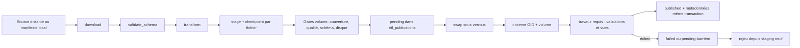

# Revue ciblée du socle d'import et de publication

Date : 2026-09-10. Lecture seule du checkout
`C:/tmp/datacommune-phase591-20260910`, HEAD
`3394395a32e9a778c89930ad7544406da265163e`. Aucun import, test distant,
accès à une base partagée ou changement de code n'a été effectué. Cette revue
complète l'audit DPE existant `dpe-code.md` sans nouvelle exploration globale.

## Verdict

Le code possède déjà un bon noyau de publication : staging, contrôles avant
bascule, double renommage transactionnel, verrou par dataset, verrou global de
publication, journal durable et reprise prudente. Il peut servir de base à une
seconde ingestion documentaire.

En revanche, il n'existe pas encore de contrat de source générique adapté à un
document sans BAN ni coordonnées. Le manifeste générique est fermé à `vacance`
et `loyers`, et DPE utilise un manifeste spécialisé fermé à quatre couples
ADEME × département. La correction et la suppression sont également des règles
métier DPE, indexées par `numero_dpe`, pas un mécanisme documentaire réutilisable.

| Décision | Mécanisme actuel | Preuves exactes | Conséquence pour une seconde ingestion |
|---|---|---|---|
| Conserver | Runner `download → validate → transform → stage`, checkpoint par fichier et reprise seulement si checkpoint **et** staging existent | `api/backend/app/etl/checkpoint.py:1-14`, `:29-42`; `api/backend/app/etl/runner.py:152-179` | Réutiliser le runner et son modèle de reprise. Donner au nouveau pipeline une clé de scope liée à la source figée. |
| Conserver | Verrou d'exécution par dataset, puis verrou global de publication | `api/backend/app/etl/publication.py:31-39`, `:143-169`; `api/backend/app/etl/runner.py:560-566` | Empêche deux producteurs du même dataset et protège la fenêtre swap/vues/métadonnées. |
| Conserver | Swap court : contraintes préparées avant, `SET LOGGED`, suppression de l'ancien `_old`, deux `RENAME` et renommage des index dans une transaction | `api/backend/app/etl/base.py:659-703` | Base fiable pour publier une table documentaire entière ; prévoir l'espace nécessaire à deux générations. |
| Conserver | Journal `etl_publications` : génération UUID, état `pending/published/failed`, OID et nombre de lignes ; métadonnées et travaux requis validés sous le même propriétaire | `api/backend/app/etl/publication.py:128-169`, `:175-196`, `:221-269`, `:282-298`; `api/backend/app/etl/runner.py:567-618` | Les lecteurs peuvent refuser une génération incomplète ; les vues requises et métadonnées ne sont pas déclarées réussies séparément. |
| Conserver | Après une publication incomplète, interdiction de reprendre l'ancien staging | `api/backend/app/etl/publication.py:20-28`; `api/backend/app/etl/runner.py:164-169` | Un rejeu post-swap repart d'une génération fraîche au lieu de recycler un état prépublication. |
| Adapter | `SourceManifest` générique, lecture stricte, hash du manifeste, copie privée vérifiée et réserve disque | `api/backend/app/etl/source_manifest.py:43-57`, `:69-107`, `:173-197`, `:207-246` | Extraire un contrat extensible par dataset. Aujourd'hui son type limite explicitement `dataset` à `vacance|loyers` (`:54`) et ses fichiers attendus viennent d'un registre fermé. |
| Adapter | `DpeImportManifest` lie les CSV, pages JSON, versions, projection, mapping et exactement quatre couples | `api/backend/app/etl_dpe/sources.py:175-184`, `:251-280`, `:402-466`; `api/backend/app/etl_dpe/reconciliation.py:259-281` | Garder les propriétés de complétude et d'intégrité, mais définir le grain et le périmètre propres à la nouvelle source ; ne pas copier la fermeture ADEME 44/85. |
| Adapter | Rejeu DPE par génération cache/checkpoint, refus d'un cache altéré | `api/backend/app/etl_dpe/pipeline.py:360-381`, `:409-440`; `api/backend/tests/test_etl_dpe_sources.py:269-294` | Distinguer clairement « reprendre la même génération figée » et « ingérer une nouvelle édition source ». |
| Adapter | Correction DPE : une identité `numero_dpe`, remplacement du payload par la génération courante ; déplacement 44↔85 sans doublon | `api/backend/app/etl_dpe/reconciliation.py:389-461`; `api/backend/tests/test_dpe_reconciliation.py:243-261` | Définir une clé documentaire stable et la règle de révision avant import. Sans clé source stable, un changement de texte ou d'adresse risque de créer un doublon ou une fausse suppression. |
| Adapter | Suppression DPE : absence prouvée sur le scope complet ⇒ tombstone, avec purge de tous les champs hors allowlist ; réapparition reprend uniquement le nouveau payload | `api/backend/app/etl_dpe/reconciliation.py:355-386`; `api/backend/tests/test_dpe_reconciliation.py:212-240` | Réutiliser le principe seulement si la source fournit un snapshot complet. Un flux delta ou une collecte partielle ne peut jamais prouver une suppression. |
| Manquant | Lien durable entre `etl_publications.generation` et le manifeste/source exact consommé | Le journal enregistre génération, dataset, table, état, OID et volume (`api/backend/app/etl/publication.py:160-169`, `:192-195`), sans empreinte de manifeste | Ajouter au contrat futur une provenance vérifiable de génération ; sinon une publication est techniquement identifiable mais son entrée source n'est pas reconstructible depuis le journal seul. |
| Manquant | Modèle documentaire neutre avant rattachement géographique | DPE rejette les coordonnées BAN invalides pendant la transformation (`api/backend/app/etl_dpe/pipeline.py:619-659`, voir aussi `dpe-code.md`) | Stocker d'abord le document et sa provenance ; rendre BAN, coordonnées et rattachement optionnels et qualifiés. |
| Manquant | Journal générique de corrections explicites et réversibles | La réconciliation DPE reconstruit l'état courant par numéro et ne conserve qu'une provenance d'observation/tombstone (`api/backend/app/etl_dpe/reconciliation.py:406-461`) | Pour corrections manuelles ou rapprochements, prévoir une décision séparée de la donnée source, datée et annulable, sans réécrire le fait importé. |

## Pipeline actuel

Pour DPE, une étape métier s'insère avant le swap : validation du manifeste
complet, registre privé de présence brute, réconciliation avec la génération
servie, tombstones, puis matérialisation du cycle de vie
(`api/backend/app/etl_dpe/pipeline.py:126-139`, `:212-263`, `:845-1029`).

## Risques spécifiques aux documents sans BAN ni coordonnées

| Risque | Effet possible | Invariant à poser avant l'ajout |
|---|---|---|
| Utiliser BAN ou la géométrie comme condition d'entrée | Perte silencieuse des documents non géocodés, comme le périmètre DPE déjà borné par BAN | La présence documentaire est indépendante du rattachement ; `ban_id` et géométrie sont nullable avec un état et un motif. |
| Déduire une identité depuis une adresse libre | Fusion de documents distincts, ou déplacement artificiel lors d'une correction typographique | L'identité vient d'une clé officielle stable ou d'une clé source composite versionnée ; l'adresse reste un attribut. |
| Considérer « non vu » comme supprimé | Tombstones massives après pagination incomplète, filtre modifié ou panne source | Suppression autorisée uniquement après preuve d'un snapshot complet, périmètre identique et manifeste validé. |
| Confondre document et association géographique | Une correction de BAN réécrit ou duplique le document | Séparer table documentaire, observations source et association qualifiée ; historiser la décision d'association. |
| Reprendre un checkpoint avec une autre édition | Mélange de fichiers de générations différentes | Inclure hash du manifeste, contrat de projection et périmètre dans `checkpoint_scope_key`. |
| Publier la table mais échouer sur les vues | API partiellement cohérente ou absence métier trompeuse | Déclarer les vues/validations requises au hook de publication et faire répondre les lecteurs « indisponible » tant que la génération n'est pas `published`. |

## Contrôles existants à réutiliser

Ces contrôles sont des cibles précises pour qualifier une seconde ingestion. Ils
n'ont pas été exécutés pendant cette revue.

| Contrôle | Tests existants | Ce qu'il faut conserver dans les nouveaux cas |
|---|---|---|
| Manifeste strict et snapshot immuable | `api/backend/tests/test_frozen_source_manifest.py::test_bad_manifest_is_refused_before_cli_can_enter_runner`; `::test_checkpoint_scope_changes_with_manifest_bytes_and_rejects_tampered_snapshot`; `api/backend/tests/test_etl_dpe_sources.py::test_manifest_requires_exact_pairs_and_completeness`; `::test_checksums_cover_raw_pages_and_csv` | Refus avant staging d'un manifeste incomplet, altéré, ambigu ou hors contrat. |
| Reprise bornée à la même génération | `api/backend/tests/etl/test_runner.py::TestResumeBothPresent`; `::TestOrphanCheckpointNoStaging`; `::TestOrphanStagingNoCheckpoint`; `api/backend/tests/test_etl_dpe_sources.py::test_resume_reuses_only_validated_generation` | Même hash + staging : reprise ; état orphelin, source changée ou publication incomplète : départ frais. |
| Bascule atomique et rejeu après défaut | `api/backend/tests/test_etl_base_swap.py::test_swap_tables_sql_sequence`; `::test_swap_tables_order`; `api/backend/tests/integration/test_dpe_source_staging.py::test_rename_failure_rolls_back_relation_and_can_retry_complete_staging` | Injecter un échec après les renommages et prouver que l'ancienne génération reste servie, puis que le même staging complet peut être rejoué avant toute publication durable. |
| Publication et travaux requis indivisibles | `api/backend/tests/integration/test_publication_owned_work.py::test_owner_transaction_commits_ddl_metadata_and_publication_together`; `::test_owner_failure_rolls_back_work_and_preserves_durable_barrier`; `::test_candidate_context_refuses_wrong_owner_or_stock` | Prouver rollback des vues/métadonnées, maintien de la barrière, refus d'un OID, propriétaire ou UUID modifié. |
| Complétude avant suppression | `api/backend/tests/test_dpe_reconciliation.py::test_any_missing_pair_refuses_absence`; `::test_complete_absence_purges_by_allowlist_and_reappearance_uses_only_new`; `::test_unexplained_or_unapproved_new_rejection_blocks` | Une page/partition manquante bloque la publication ; seule l'absence dans un snapshot complet crée une tombstone ; la réapparition ne ressuscite pas les anciens champs. |
| Génération DPE réelle en staging | `api/backend/tests/integration/test_dpe_source_staging.py::test_missing_source_before_swap_keeps_previous_generation`; `::test_raw_collision_aborts_before_transformation_or_rename`; `::test_raw_geometry_rejection_never_becomes_a_false_source_absence`; `::test_document_move_or_reappearance_uses_only_current_payload` | Adapter avec fixtures sans BAN/coordonnées : le document reste présent, une collision de clé bloque, et une correction ne devient jamais une suppression. |
| Index et contraintes après publication | `api/backend/tests/etl/test_dpe_swap_preserves_migration_indexes.py::test_pipeline_rebuilds_every_column_a_migration_indexes`; `::test_retry_resets_only_staging_uniqueness_before_reconciliation`; `api/backend/tests/test_etl_base_swap.py::test_prepare_staging_constraints_commits_before_swap` | Vérifier PK/UNIQUE avant la bascule et noms/index canoniques après deux publications successives. |
| Lecteur cohérent avec la génération | `api/backend/tests/integration/test_dpe_inventory_generation.py::test_failed_swap_rollback_preserves_data_facts_and_references`; `::test_repeatable_read_keeps_page_and_aggregate_on_one_snapshot`; `::test_rename_is_blocked_by_parent_locks_and_invalidates_old_context` | Une lecture ne mélange pas deux générations et un échec de publication ne devient pas un résultat vide. |

Le contrôle minimal de la **seconde** publication doit donc utiliser deux
manifestes synthétiques successifs : le premier crée des documents dont certains
n'ont ni BAN ni coordonnées ; le second corrige un document, en déplace un,
retire explicitement un document dans un snapshot complet et en ajoute un. Les
assertions doivent porter sur la clé stable, les champs source intacts, la
tombstone minimale, le hash de provenance, l'OID publié, le volume, les contraintes
et l'absence de mélange entre générations. Un second scénario identique mais avec
une page manquante doit échouer avant swap et laisser intégralement la première
génération servie.

## Limites

Cette revue atteste les mécanismes présents dans le code au SHA indiqué, pas leur
état en CI ou en production. Elle ne conclut pas qu'un nouveau dataset est prêt :
la clé documentaire, le contrat de correction/suppression, le manifeste générique
et le lien manifeste-publication restent à spécifier avant toute implémentation.
